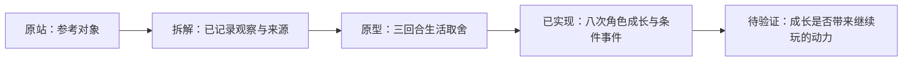

# Life Sim Product Study

一次对 [1in8b.life](https://1in8b.life/) 的产品拆解与独立复刻实验。

**当前试玩：[城南八周](https://three-weekends-yuki.yuki-uix.chatgpt.site/)** · [实现与运行说明](web/README.md)

当前阶段关注：**角色从生疏到熟练，能力触发新事件，实际经历逐渐形成身份，并能继续使用成长结果。**

本项目通过体验走查、公开实现参考和独立原型，研究随机出生、人生事件与玩家选择。Sharing 已调整为后续补充功能；首版保留结构化事件记录，以支持将来的事件挑选和分享。

## 项目身份与当前状态

- 这是独立研究项目，与原作者没有隶属或合作关系。
- 复刻范围是产品机制与交互流程；实现、文案和视觉另行制作。
- 原站源码未公开；相关二创仓库只作为参考，不能视为官方实现。
- v0.1「三个周末」收到「不好玩，没有养成系的感觉」的直接试玩反馈。
- 当前已实现 v0.2「城南八周」：2 项能力、4 个条件事件、8 次行动；新一轮趣味性仍待用户试玩。
- 用户明确选择养角色，并要求能力决定可以触发哪些事件。
- 已确认的范围调整：sharing 后置，人生事件的持久记录纳入首版设计。
- 原先 20 项事件方案已后置，不是当前第一层的任务清单。
- 除上述已确认调整外，其余范围、时长、指标与技术方案仍为提案，等待讨论和验证。

## 先读这些

| 文档 | 内容 |
| --- | --- |
| **[独立产品分析](docs/lead-product-analysis.md)** | **Lead Product Analyst 对动机、核心体验和 MVP 的重新审视** |
| [分析角色说明](agents/lead-product-analyst.md) | 可复用的分析职责与交付边界 |
| [游戏设计评估](docs/lead-game-design-review.md) | 少前情、先行动、动作后的场景回响 |
| [游戏设计角色](agents/lead-game-designer.md) | Lead Game Designer 的职责与交付边界 |
| **[当前 MVP，已实现待试玩](docs/mvp-minimal.md)** | **两项能力、四个条件事件，验证成长与身份的实际用途** |
| [可玩实现](web/README.md) | 在线入口、运行方式、参数、存档与验证 |
| [原 MVP 草案](docs/mvp.md) | 已后置的较完整方案，不是当前执行范围 |
| [核心玩法 v0.1](docs/gameplay-v0.1.md) | 后续候选：数值、关系、健康与年度调度 |
| [事件目录 v0.1](docs/event-catalog-v0.1.md) | 后续候选：20 个事件定义 |
| [事件记录设计](docs/event-records.md) | 基本记录能力与未来复杂玩法的扩展参考 |
| [研究记录](docs/research-notes.md) | 已观察到的机制、官方声明、参考仓库与未验证事项 |

## 当前可玩范围

一个青年期角色，在同一条街上度过八周。整理书架或练习速写，达到能力门槛后出现独立任务；实际做过任务并继续练习，才有机会策划书桌或完成作品、形成身份。身份后的两周仍能承担新的职责。

两条方向是沿用现有内容的验证样本，不代表用户已确认偏爱某个职业。资金、时间与不同成果保留取舍；没有人生总分。完整职业树、关系、国家、全人生、sharing 与共同在场继续后置。

首版保存能力变化、实际选择、机会触发来源、任务与身份事实、当时文字。后续分享从这些记录读取，不补写没有发生过的经历。

## 研究原则

1. **区分证据与判断。** 原站实际行为、作者声明、二创实现和我们的提案分别记录。
2. **来源声明不等于数据核验。** 核验时记录字段、年份、单位、出处、处理方法和缺失值。
3. **国家均值不等于个人概率。** 模拟假设单独标注，不把游戏结果解释成真实人生预测。
4. **先保留人生经历。** 当前状态与已发生事件分别保存，后续再决定哪些值得分享和怎样呈现。
5. **代码生成后仍需验收。** 页面存在不代表路径可用，本地数据不代表跨用户社区已经完成。
6. **未来分享单独验证。** 点击分享不等于发送成功；届时区分曝光、分享操作、链接访问与新玩家开局。

## 参考

- [原站](https://1in8b.life/)
- [官方产品与制作说明](https://1in8b.life/en/about/)
- [官方隐私政策：源码保存在私有仓库](https://1in8b.life/en/privacy/)
- [官方使用条款](https://1in8b.life/en/terms/)
- [二创参考：rollroyces/born-somewhere](https://github.com/rollroyces/born-somewhere)
- [派生参考：juren056/1in8billion.live](https://github.com/juren056/1in8billion.live)

本仓库不包含原站源码、原站素材或上述二创的代码。参考链接不代表已经核实其全部实现、数据或授权链。
