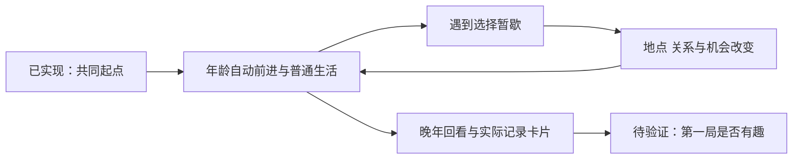

# Life Sim Product Study

一次对 [1in8b.life](https://1in8b.life/) 的产品拆解与独立复刻实验。

**当前 MVP：中国背景，完整一生。** 从一个具体的人生起点走到晚年与结束，普通生活自然经过，少数重要选择改变后来的人、地方和机会，最后由玩家挑选实际经历生成分享卡。

**[打开完整一生试玩](https://three-weekends-yuki.yuki-uix.chatgpt.site/life/)**。首版已实现陈知夏从出生到85岁结束的连续时间线，18岁后可走向外省或本地生活，再继续决定迁居、相处和留下的东西。结尾可以挑选本局经历，填写自己的话并保存PNG卡片。

## 当前范围与内容

| 文档 | 用途与状态 |
| --- | --- |
| **[中国完整一生 MVP](docs/china-life-mvp.md)** | **当前范围的唯一入口：体验目标、已实现边界、后置项目与验收** |
| **[两条完整纸面试玩](docs/china-life-paper-playthroughs.md)** | **已实现内容的纸面基线：同一出生卡、不同走法、后续回响与分享卡样稿** |
| [事件记录设计](docs/event-records.md) | 记录本局实际事实、亲历与来源，支撑首版回顾与卡片；复杂字段为扩展参考 |

两条样本都从陈知夏、2005年出生的澄江维修铺家庭开始。A在18岁去外省，经历迁居、同住与晚年回乡；B留本地，经历旧街采录、关系变化、社区小组和迟来的旅行。相同的老街改造发生在不同生活处境中。两条固定85岁结束，作为当前对照条件，不作为中国人口或寿命模型。

精简分享卡已进入首版：从实际记录挑内容、可选个人感想、预览并保存图片。公开社区、真实在线人数、大量模板与商业化后置。随机出生卡数量、随机寿命、并行模拟人物、数值面板和固定单局时长尚未由这两条样本确定。

两条主路线及已有选项的后续均已接通，规则检查覆盖40种完整选择组合；这不是40个独立编写的结局，也不代表好玩已验证。下一步通过实际首玩，检查玩家是否想知道后来、能否在意并认出回响、是否愿意回看或表达这一生。

## 历史原型与研究

| 项目 | 状态 |
| --- | --- |
| [八天校园原型](https://three-weekends-yuki.yuki-uix.chatgpt.site/fridays/) | 保留的历史实现，含今日安排与周五放映；[具体范围](docs/two-fridays-slice.md) |
| [秋季日历原型](https://three-weekends-yuki.yuki-uix.chatgpt.site/autumn.html) | 三个月日历与双向相处的历史对比入口 |
| [实现与本地运行](web/README.md) | 现行完整一生及历史原型的源文件、存档、检查与运行说明 |
| [校园范围历史](docs/china-mvp-scope.md) | 大学四年提案及v0.3—v0.9的历史调整 |
| [八周原型历史](docs/mvp-minimal.md) | v0.2的能力与任务方案 |
| [较早的完整 MVP 草案](docs/mvp.md) | 多国家、20项事件等旧提案，不作为当前任务清单 |
| [历史产品分析](docs/lead-product-analysis.md) | 当时对经营、人生最优解与分享的判断，不能替代现行范围 |
| [历史游戏设计评估](docs/lead-game-design-review.md) | 早期叙事、成长与一手设计参考 |
| [原作时间与节奏复核](docs/one8b-time-rhythm.md) | 原站公开发布脚本与运行观察的证据及限制 |
| [研究记录](docs/research-notes.md) | 原站说明、参考仓库、历史范围与未核实事项 |
| [产品分析角色](agents/lead-product-analyst.md) / [游戏设计角色](agents/lead-game-designer.md) | 可复用的评估职责 |

## 研究原则

- 这是独立研究，与原作者无隶属或合作关系。实现、文字和视觉独立制作，不包含原站源码或素材。
- 区分原站观察、作者声明、模型假设和我们自己的设计。原站声称使用公开统计，不等于本项目完成了资料核验。
- 当前人物、城市和未来事件均为虚构，不用国家均值解释个人命运，不伪造真实在线玩家或群体百分位。
- 人生回顾与分享卡只引用本局实际事实；收到视频不等于亲历，素材存在不等于作品完成或展出。
- 规则、分支与存档检查保证流程可用，不能单独证明趣味成立；点击保存或分享也不等于内容已发送或传播有效。

## 参考

- [原站](https://1in8b.life/) / [官方制作与玩法说明](https://1in8b.life/en/about/)
- [官方隐私政策](https://1in8b.life/en/privacy/) / [使用条款](https://1in8b.life/en/terms/)
- [二创参考 rollroyces/born-somewhere](https://github.com/rollroyces/born-somewhere)
- [派生参考 juren056/1in8billion.live](https://github.com/juren056/1in8billion.live)

参考仓库不视作官方源码，链接不代表已核实其全部实现、数据或授权链。
