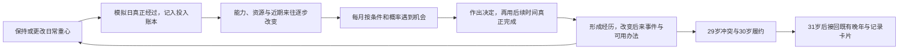

# Life Sim Product Study

一次对 [1in8b.life](https://1in8b.life/) 的产品拆解与独立复刻实验。

**[打开当前试玩](https://three-weekends-yuki.yuki-uix.chatgpt.site/replica/)**。首页与原 `/life/` 地址都会进入这里。当前版本已从界面复刻进入核心循环验证：日常按真实经过的模拟日累计，改变能力、资源与近期关系，再影响可能遇到的事件及可用办法。[核心机制与证据边界](docs/one8b-core-mechanics.md)。

**连续投入仍只覆盖去外省后的23—30岁。** 可从23岁固定前情开始，也可从出生走到18岁选择去外省；31岁以后和留本地路线大部分继续沿用既有叙事。流程能走到85岁，不代表整个人生或全球模拟已经完成。

固定样本是陈知夏、2005年出生于澄江维修铺家庭，所有走法在2090年、85岁结束。人物、城市和未来经历均为虚构；这些是内容对照条件，不是中国人口、寿命或机会概率模型。

## 当前范围与内容

| 文档 | 用途与状态 |
| --- | --- |
| **[中国完整一生 MVP](docs/china-life-mvp.md)** | **当前范围入口：23—30岁连续投入、条件机会、已实现边界与验收** |
| [核心循环与原作证据](docs/one8b-core-mechanics.md) | 区分原作已观察机制、本项目独立参数与尚未核实的部分 |
| [两条完整纸面试玩](docs/china-life-paper-playthroughs.md) | 保留的内容基线；本轮未重写，不代表现行机会与投入规则 |
| [实现与本地运行](web/README.md) | 当前与历史入口、源文件、存档和检查说明 |
| [上一轮界面复刻记录](docs/one8b-replica-ux.md) | 历史观察与当时仅复刻界面的范围，不再作为当前规则说明 |

作品、来往、安顿三种重心持续生效。切换只改变之后的投入，不能重写已经度过的时间；暂停、后台和待答期间不累计。界面显示本年与跨年的实际投入。准备和熟练增长也有备用金、精力或相处方面的代价。

互看素材、周舟采录与专精后续按实际条件和种子抽取，不再把共同剪辑固定在25—26岁。选择结构或声音方向不立即完成练习；接受共同片段也不立即获得合作事实，必须把后来的时间真的留出来。普通熟练度、常来往和真正共同做过事分别记录，后来同样的日常可以沿不同历史走向不同机会。

29岁仍有搬店与投稿的共同外部冲突。准备、精力、钱和实际合作改变处理办法与不可行原因；完整版、精简版、共同署名和陪家人保留不同内容代价。共同署名后的承诺还会占用30岁的真实投入，完成后才记履约。

默认检查覆盖分段投入、同年切换、机会条件与种子重放、方向及合作的实际完成、29岁办法、后续义务、完整人生接续、文字快照、旧存档迁移和界面时钟。测试数量不当作独立内容篇数，规则通过也不代表好玩已验证。重点仍是玩家能否说清自己的投入、为什么遇到一件事，以及过去选择怎样改变后来能做的事。

当前状态版本为3，保存到 `china-life.replica.save.v3`。已有的复刻页v2存档经严格核验后接续，但新账本只从接入当天开始，不倒填过去投入；旧键保留。原v2阅读界面及 `china-life.save.v2` 在 **[上一版对照](https://three-weekends-yuki.yuki-uix.chatgpt.site/life/previous.html)** 保留；更早v1仍由 `/life-v1/` 读取。分享卡只取本局实际记录。更多国家、随机出生与寿命、完整职业经济、自由社交网、并行同龄人及公开分享社区仍后置。

## 历史原型与研究

| 项目 | 状态 |
| --- | --- |
| [上一版v2界面](https://three-weekends-yuki.yuki-uix.chatgpt.site/life/previous.html) | 冻结的年度结算与阅读界面，继续读取原v2存档 |
| [上一版完整人生](https://three-weekends-yuki.yuki-uix.chatgpt.site/life-v1/) | 冻结的既有叙事实现，继续读取原v1存档 |
| [八天校园原型](https://three-weekends-yuki.yuki-uix.chatgpt.site/fridays/) | 保留的历史实现，含今日安排与周五放映；[具体范围](docs/two-fridays-slice.md) |
| [秋季日历原型](https://three-weekends-yuki.yuki-uix.chatgpt.site/autumn.html) | 三个月日历与双向相处的历史对比入口 |
| [实现与本地运行](web/README.md) | 现行完整一生及历史原型的源文件、存档、检查与运行说明 |
| [校园范围历史](docs/china-mvp-scope.md) | 大学四年提案及v0.3—v0.9的历史调整 |
| [八周原型历史](docs/mvp-minimal.md) | v0.2的能力与任务方案 |
| [较早的完整 MVP 草案](docs/mvp.md) | 多国家、20项事件等旧提案，不作为当前任务清单 |
| [历史产品分析](docs/lead-product-analysis.md) | 当时对经营、人生最优解与分享的判断，不能替代现行范围 |
| [历史游戏设计评估](docs/lead-game-design-review.md) | 早期叙事、成长与一手设计参考 |
| [原作时间与节奏复核](docs/one8b-time-rhythm.md) | 原站公开发布脚本与运行观察的证据及限制 |
| [研究记录](docs/research-notes.md) | 原站说明、参考仓库、历史范围与未核实事项 |
| [产品分析角色](agents/lead-product-analyst.md) / [游戏设计角色](agents/lead-game-designer.md) | 可复用的评估职责 |

## 研究原则

- 这是独立研究，与原作者无隶属或合作关系。实现、文字和视觉独立制作，不包含原站源码或素材。
- 区分原站观察、作者声明、模型假设和我们自己的设计。原站声称使用公开统计，不等于本项目完成了资料核验。
- 当前人物、城市和未来事件均为虚构，不用国家均值解释个人命运，不伪造真实在线玩家或群体百分位。
- 人生回顾与分享卡只引用本局实际事实；收到视频不等于亲历，素材存在不等于作品完成或展出。
- 规则、分支与存档检查保证流程可用，不能单独证明趣味成立；点击保存或分享也不等于内容已发送或传播有效。

## 参考

- [原站](https://1in8b.life/) / [官方制作与玩法说明](https://1in8b.life/en/about/)
- [官方隐私政策](https://1in8b.life/en/privacy/) / [使用条款](https://1in8b.life/en/terms/)
- [二创参考 rollroyces/born-somewhere](https://github.com/rollroyces/born-somewhere)
- [派生参考 juren056/1in8billion.live](https://github.com/juren056/1in8billion.live)

参考仓库不视作官方源码，链接不代表已核实其全部实现、数据或授权链。
