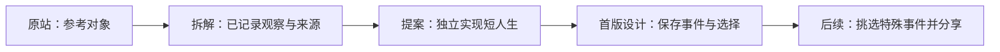

# Life Sim Product Study

一次对 [1in8b.life](https://1in8b.life/) 的产品拆解与独立复刻实验。

第一阶段关注：**出生条件与选择怎样形成一段自洽、能被记住的人生，并完整保存其中的特殊事件。**

本项目通过体验走查、公开实现参考和独立原型，研究随机出生、人生事件与玩家选择。Sharing 已调整为后续补充功能；首版保留结构化事件记录，以支持将来的事件挑选和分享。

## 项目身份与当前状态

- 这是独立研究项目，与原作者没有隶属或合作关系。
- 复刻范围是产品机制与交互流程；实现、文案和视觉另行制作。
- 原站源码未公开；相关二创仓库只作为参考，不能视为官方实现。
- 当前完成的是项目说明、MVP 核心玩法与事件目录提案，尚未开始编写游戏。
- 已确认的范围调整：sharing 后置，人生事件的持久记录纳入首版设计。
- 除上述已确认调整外，其余范围、时长、指标与技术方案仍为提案，等待讨论和验证。

## 先读这些

| 文档 | 内容 |
| --- | --- |
| [MVP 草案](docs/mvp.md) | 人生体验、首版范围、完成标准与工作量 |
| [核心玩法 v0.1](docs/gameplay-v0.1.md) | 数值、教育/职业/关系链、年度调度与扩展边界 |
| [事件目录 v0.1](docs/event-catalog-v0.1.md) | 20 个事件定义、具体选项、即时与后续影响 |
| [事件记录设计](docs/event-records.md) | 特殊事件如何保存、恢复，以及怎样供未来 sharing 使用 |
| [研究记录](docs/research-notes.md) | 已观察到的机制、官方声明、参考仓库与未验证事项 |

## 建议的第一阶段

用单语言、少量国家和事件，跑通 **出生 → 短人生与选择 → 事件时间线 → 结局摘要**。

第一轮建议为 5 个国家背景、20 个事件定义、常见 6–9 次选择，目标约 3–5 分钟的一生。只做一位重要他人、三条教育路线和有限职业成长。国家数量、事件数量和时长均是缩小实验范围的设计选择，不是原站配置。

当前提案用 80 岁演示终点，健康先影响工作与晚年状态；国家先展示核验过的背景，家境与选择驱动主要因果链。这两项是明确的首版取舍，仍需讨论，不宣称已经模拟真实国别机会或死亡概率。

首版需要保存已发生事件的事实、玩家选择、结果和当时文案。之后的分享卡、结果页和传播统计再从这些记录中取数据，具体边界见 MVP 草案和事件记录设计。

## 研究原则

1. **区分证据与判断。** 原站实际行为、作者声明、二创实现和我们的提案分别记录。
2. **来源声明不等于数据核验。** 核验时记录字段、年份、单位、出处、处理方法和缺失值。
3. **国家均值不等于个人概率。** 模拟假设单独标注，不把游戏结果解释成真实人生预测。
4. **先保留人生经历。** 当前状态与已发生事件分别保存，后续再决定哪些值得分享和怎样呈现。
5. **代码生成后仍需验收。** 页面存在不代表路径可用，本地数据不代表跨用户社区已经完成。
6. **未来分享单独验证。** 点击分享不等于发送成功；届时区分曝光、分享操作、链接访问与新玩家开局。

## 参考

- [原站](https://1in8b.life/)
- [官方产品与制作说明](https://1in8b.life/en/about/)
- [官方隐私政策：源码保存在私有仓库](https://1in8b.life/en/privacy/)
- [官方使用条款](https://1in8b.life/en/terms/)
- [二创参考：rollroyces/born-somewhere](https://github.com/rollroyces/born-somewhere)
- [派生参考：juren056/1in8billion.live](https://github.com/juren056/1in8billion.live)

本仓库不包含原站源码、原站素材或上述二创的代码。参考链接不代表已经核实其全部实现、数据或授权链。
