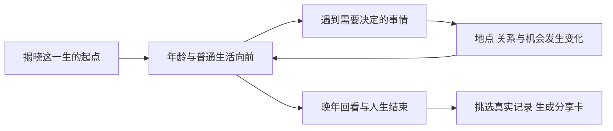

# 中国完整一生 MVP 范围

更新：2026-10-28。状态：已按用户认可的两条纸面试玩调整规划，尚未实现。本轮只更新范围、内容与验收文档，暂不修改应用代码或部署。

本页是当前 MVP 范围的唯一入口。具体内容基准见 [两条完整纸面试玩](china-life-paper-playthroughs.md)。既有校园、八天排程与放映室版本保留为历史原型，不能据此宣称本方案已可在线体验。

## 体验目标

在中国背景下，从一个具体的人生起点走到晚年与生命结束。普通生活自然经过，少数重要选择逐渐改变居住地、相处的人、后来能做的事和留下的东西；最后由玩家决定怎样记住、保存和表达这一生。

首版的完整性来自出生至结束的连续经历；不据此扩展纸面以外的婚育、医疗或完整职场制度。

第一局要让玩家产生对后续的好奇、对人物与经历的牵挂，以及回看时认出过去选择的满足。不以完成排程、练满技能、获得统一成功称号为主线，也不把长期刷局作为这次验证目标。

## 首版边界

| 项目 | 当前范围 |
| --- | --- |
| 国家与世界 | 中国；城市、人物、未来事件均为虚构，不宣称模拟真实人口概率或预测中国社会 |
| 起点 | 先使用陈知夏这一张固定出生卡：女性，2005年出生，澄江，父母经营家电维修铺。入口明确是固定人物样本，不伪装成随机抽样 |
| 时间跨度 | 从出生、童年走到成年、中年、晚年与结束。当前两条对照样本均在2090年、85岁结束；这是样本条件，不是平均寿命或正式死亡模型 |
| 内容基准 | 两条完整示范走法：18岁去外省，或留本地；此后继续根据当时处境选择，可以再次迁居、改变相处或生活安排 |
| 决策预算 | 纸面A有5次、B有6次关键选择；共10个决策情境，18岁节点共用。其他组合按实际情境展开，不为凑次数强插事件 |
| 日常节奏 | 保留童年、上学、工作、家务、相处和衰老等普通时光，每条示范至少6段。年龄保持清晰、连续的推进感，平静年份简写，不要求逐日排程或逐年点击 |
| 贯穿人物 | 周舟为共同关系；宋闻出现在A，许阳与小尹在B的不同阶段出现。父母是固定家庭角色，不扩完整族谱或自由社交网 |
| 成长 | 从实际做过的事与长期生活中形成经验，改变后续能参与的事和他人的回应；不单独承诺技能树、经验条或固定等级门槛 |
| 结果 | 由实际经历生成的人生回顾，呈现得到、错过及未完成的事，不给人生总分，不强制每条路圆满或附上一段遗憾 |
| 分享 | 首版包含一张简版卡：从本局挑选记录、可选个人感想、预览并保存图片；两条样本使用同一模板，内容来自不同事实 |
| 基础体验 | 克制文字与像素表现，最新日志在上，本地保存与恢复当前人生，结束后可重看记录与卡片、重新开始 |

纸面认可说明当前内容可以继续推进，不代表首玩趣味已经验证。固定起点只能先检验选择、时间与回顾的体验，不能据此证明随机出生的吸引力。

## 两条示范的内容与回响

出生及童年共用：父母的维修铺、同桌周舟、10岁录下的街声。18岁志愿选择是第一次分岔。2034年老街改造是共同的外部事件，不由玩家是否离家造成。

| 年龄 | A 去外省的示范选择与结果 | B 留本地的示范选择与结果 |
| --- | --- | --- |
| 18 | 去岚城读数字媒体，后来到临港工作；新的居住地与相处机会随之出现 | 留在澄江读同一专业，后来做本地音频工作；住得近也仍需主动相处 |
| 29 | 回乡陪父母搬店，亲手录下旧铺最后关门；错过个人短片投稿，草稿没有完成 | 和周舟完整采录十三家店；父母关门时不在场，收到母亲拍的视频，晚上再去帮忙 |
| 33—42 | 经周舟的来访认识宋闻；40岁合住，接受更长通勤并逐渐建立共同生活 | 与许阳交往；40岁先试异地，42岁再讨论长期住处，选择分开 |
| 55 | 翻新厨房，把北方旅行往后放；本条走法后来始终没有安排成行 | 把课程收为每月小组，部分学员离开，小尹留下；相处和自己的时间发生变化 |
| 68以后 | 自己先回澄江试住，宋闻有自己的打算；经过几个冬天，71岁才共同定居 | 与周舟去海边两周，错过当届声音展；晚年小尹保存素材，也反过来帮助自己 |
| 结束回看 | 三座居住城市、私人关门录音、与宋闻的共同生活、未完成的片子和旅行 | 本地生活、十三家店的原始录音、结束的伴侣关系、小组与海边旅行 |

这两条是可读的完整样本，不是只让玩家先选A/B、再播放整篇故事的两个预制结局。

## 选择与事件规则

1. **眼前的代价可理解，远期故事保留未知。** 选项说明当前知道的时间、距离、承诺与资源取舍，不提前公布全部结局和未来门槛。
2. **结果改变后来的生活。** 迁居影响接触的人和相处方式；参与采访留下公共素材；合住需要协商；关系结束不被一句结尾文案抹去。
3. **普通日子不逐次领奖。** 有些投入只留下熟悉、能力或细小习惯，后来的某次事件才让玩家认出它们的作用。
4. **世界与人物也独立变化。** 老街会改造，父母会老去，伴侣有自己的住处与工作打算。玩家不能用一次按钮替所有人作决定。
5. **亲历与收到记录不同。** B看到母亲的关门视频，不等于当时在场；录下十三家店，也不等于已经剪成作品、提交或展出。
6. **一次决定不永久锁死人生。** 18岁留本地，后来仍可能离开；55岁翻新厨房，只是这次没有旅行，不自动禁止余生出发。
7. **允许部分兼顾，也保留无法补回的事情。** B可以先交作品、再赶上海边最后几天；错过当届展览的事实不会因晚年有人保存素材而消失。
8. **不同生活不作统一排序。** 不用收入、关系总分、迁居次数或作品数量宣布哪一生更成功。

## 从纸面到可玩的内容缺口

当前只写完整了两条实际走法。其余已展示选项的后续情境、可选行动和回顾规则还需要补齐；不能将任意选择强行接回现有结尾。

| 未走出的选项 | 补写与验收要求 |
| --- | --- |
| A29留下完成短片 | 投稿与是否入选分别记录；不能仍写亲历父母关门，也不自动授予奖项 |
| A40继续各住 | 后续相处按各住事实写，不默认已经合住，也不直接判定关系失败 |
| A55先旅行 | 记录实际出发的地点与经历；分享卡不能保留“北方始终没去” |
| A68留在临港 | 不能自动发生71岁迁回澄江，人物关系与晚年地点按实际选择接续 |
| B29先陪父母 | 记录本人实际在场的经历；周舟独自完成多少素材另有事实，不固定套用十三家 |
| B40与许阳一起搬走 | 生活可以离开澄江；42岁的异地分手情境不应照常触发 |
| B42去住半年 | 继续写试住与双方打算，不直接沿用“已经分手”的记录 |
| B55扩大课程 | 课堂范围、自己的时间与学员关系改变，不统一折算成好感奖励 |
| B68先交作品再会合 | 完成、提交、入选、展出分别判断；海边只记录实际参加的几天 |

分支可以汇合，但地点、关系、作品、亲历和错过的事实须保留。新增内容先用于补齐这些已有选择，暂不新增出生卡、独立主线或通用模拟系统。

## 分享卡进入首版

玩家结束后先看人生回顾，再挑选适合放进卡片的记录。可预选约3条供替换、删除，也可挑一件未完成的事；不强制必须分享或展示遗憾。

卡片包含姓名、国家、出生与结束年份、年龄、选中的真实记录，以及可留空的玩家文字。同一模板应能呈现A/B的不同人生，不用稀有度、排名、虚构百分位或“战胜多少人”制造价值。

文案只从已发生的记录提炼，保留来源；玩家感想由本人输入，纸面示例不能自动冒充玩家的真实感受。原始录音存在、作品完成、投稿、展出应为不同事实。

首版完成到预览与本地图片保存。系统分享面板、公开结果链接、站内社区、真实在线人数、跨设备账号、支付和大量样式模板后置。保存图片不等于已发送或证明传播有效。

## 记录能力与实现约束

后续实现至少保留：当前年龄与年份、所在城市、角色与关系事实、已结算选择、事件顺序及当时文案，以及后续回响的来源。分享卡读取同一份记录，不另编一段更漂亮的人生。

刷新应回到同一处境，不能重抽既有结果、重复结算或把待答选择当成已经发生。普通日志、关键抉择、外部变化和玩家选出的分享内容分别可识别。具体接口与架构不在本轮定案；旧校园系统仅供参考，不自动成为新实现的必用框架。最低记录原则见 [事件记录设计](event-records.md)。

## 明确后置与待定

**后置：** 全球国家模型、真实人口概率与死亡风险、随机灾难池、职业市场与投资经济、完整养育与族谱、恋爱攻略系统、每日课表或体力管理、技能树、实时AI生成事件、账号与多人社区、排行与商业化。

| 尚未确认 | 当前处理 |
| --- | --- |
| 随机出生卡的数量与差异 | 先验证这一张固定样本，再判断是否增加新出身；不承诺3张或更多 |
| 随机寿命与结束年龄规则 | 85岁仅是本次对照条件，正式规则另定；不引用国家平均寿命替代死亡年龄 |
| 同时长大的模拟同龄人 | 原作乐趣的独立假设，本轮纸面未涵盖，暂不增加两位或四位并行角色 |
| 数值条与长期重心的界面 | 需要时用于解释实际变化，不预先建设多套属性或加点系统 |
| 单局时长与时间速度 | 以完整纸面朗读和后续首玩测得，不把“10分钟”当已验证目标或固定验收线 |

## 验收与下一步

内容与流程必须满足：

- 能从出生走到结束，年龄、年份、住处、人物关系与生存状态一致。
- 两条示范可按实际选择走完，既有其他选项也有可继续的后续，不出现死路或错误接回。
- 至少能辨认出早期经历在多年后改变了相处、机会或可做的事；不把共同外部变化伪装成玩家选择的奖励或惩罚。
- 不同组合的人生回顾与卡片只包含本局实际发生的事，能说明生活、关系和留下的东西的具体差异。
- 保存恢复、待答选择和已结算结果一致；普通记录最新在上，不要求每次选择后再手动开启时间。
- 分享内容可挑选、改写个人感想、预览与保存，不冒充已经发布。

趣味验证另看三个问题：起点揭晓后是否想知道后来；中途是否开始在意某个人或选择，并认出过去的回响；结束后是否能讲出一件本局发生的事，愿意回看、留下或表达。规则检查通过与用户认可纸面方向，都不等于这些已经成立。

后续顺序是：补齐现有选项的后续和来源 → 再读两条可转向的完整经历 → 用户要求实现后再制作交互版本 → 观察第一局，再决定扩展背景或系统。本轮止于文档调整。

## 历史与参考

- [两条完整纸面试玩](china-life-paper-playthroughs.md)：本轮内容基准与分享卡样稿。
- [原作时间与节奏研究](one8b-time-rhythm.md)：历史观察与证据边界。
- [校园方案历史](china-mvp-scope.md)：大学四年及v0.3—v0.9的历史范围，不是当前计划。
- [八天原型](two-fridays-slice.md)：现有线上实现，与本规划分开。
