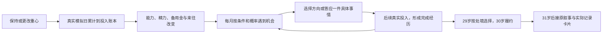

# 中国完整一生 MVP 范围

更新：2026-10-29。状态：默认试玩已接入v3连续投入、条件机会与完成历史。[进入当前试玩](https://three-weekends-yuki.yuki-uix.chatgpt.site/replica/)；首页及原 `/life/` 地址都进入这里。[原v2界面与存档](https://three-weekends-yuki.yuki-uix.chatgpt.site/life/previous.html)和[更早v1](https://three-weekends-yuki.yuki-uix.chatgpt.site/life-v1/)保留。

本页是当前MVP范围入口。[两条完整纸面试玩](china-life-paper-playthroughs.md)保留为内容基线；现行投入与机会规则以本页为准。原作证据和独立设计的区别见[核心机制](one8b-core-mechanics.md)，实现与检查见[web/README](../web/README.md)。

## 体验目标

在中国背景下，从一个具体起点走到晚年与生命结束。日常自然经过，持续投入改变能力、资源与关系；少数机会读取这些状态和真实前史，重要决定再改变后来能做的事与留下的东西。最后由玩家选择怎样记住和保存这一生。

**连续投入与条件机会只覆盖去外省后的23—30岁。** 可从固定前情的23岁开始，或从出生走到18岁后选择外省。留本地路线和31岁以后大部分接原叙事；页面能走到85岁，不等于已完成贯穿整个人生的模拟。婚育、医疗、完整职场制度和全球人口模型不在本轮范围。

第一局要让玩家对后续好奇、在意人物与经历，并能认出过去选择怎样影响现在。不以练满所有数值、清空任务或获得统一成功称号为主线。

## 首版边界

| 项目 | 当前范围 |
| --- | --- |
| 国家与世界 | 中国；城市、人物、未来事件为虚构，不宣称模拟真实人口概率或预测中国社会 |
| 起点 | 陈知夏：女性，2005年出生于澄江维修铺家庭。23岁快捷入口明示固定外省求学前情，不伪装随机抽样或逐次亲选的前史 |
| 时间跨度 | 出生至2090年、85岁结束；固定结束年龄为样本条件，不是平均寿命或正式死亡模型 |
| 连续投入 | 仅外省23—30岁；一年简化为360模拟日，每30日作月检查。实际日数决定本年和跨年账本，不采用年末最后一次重心覆盖整年 |
| 机会与决定 | 保留既有故事节点，新增真实练习、近期状态和前次选择约束下的互看素材、周舟采录及专精后续；机会按种子与概率出现，不保证每局全遇到 |
| 成长 | 作品准备、一般熟练、结构或声音的实际经验、共同完成经历分别记录；精力、钱与近期联系保留代价，不建设统一等级树 |
| 贯穿人物 | 周舟为共同关系；宋闻、许阳与小尹沿原路线出现。父母为固定家庭角色，不扩完整族谱或自由社交网 |
| 结果 | 按实际事实生成回顾；不给人生总分，不强制每条路圆满或附上遗憾 |
| 分享 | 一张本地卡片，从实际记录中选择经历、填写感想、预览和保存；不自动发布，不伪造百分位或在线玩家 |
| 基础体验 | 浅色生活主界面、顶部时间控制、直接重心、投入账本、短日志与加星；重要决定弹窗，收起仍等待，作答后恢复原来的模式 |

纸面认可、流程接通和规则检查不证明首玩趣味。当前只检验这段循环能否让玩家理解投入、机会的来由和后续区别，不据此证明随机出生或整个人生的趣味。

## 本轮23—30岁的机制验证

作品、来往、安顿三种重心会持续，可以随时改变。选中不即时推进时间、加经验或完成作品，只有模拟日真的经过，才按当时的重心累计并产生状态变化。暂停、后台和待答期间不累计；倍速改变现实等待，不改变相同虚拟时间的规则。

界面显示本年的自主投入与跨年累计。比如先给作品留45天，再安顿30天，应保留作品1.5个月、安顿1.0个月；最后切一次重心不能改写此前投入。履约占用的日数单列，避免一段时间同时记到自己的练习。

### 机会读取状态和前史

- **互看素材。** 实际练过一段时间、具备基本熟练且精力允许后，才可能遇到同事邀请。选择结构或声音仅确定方向，之后仍须真实投入才能记成完成过的经验。
- **周舟采录。** 来往的实际累计与近期能联系上的处境，让周舟可能主动来问。可以共同处理、只帮联络或坦白接不下。答应共同处理只是开始；没有真正做完，不会获得合作事实。
- **专精后续。** 结构或声音经验真实完成、又继续练习之后，后来可能分别遇到试剪互看或录音整理。一般熟练度相同也不能互相替代不同方向的经历；接受以后还要再留真实时间做完。

每月把资格与概率分开处理，并保留冷却和已发生事实；不是固定到25或26岁就发合作任务。普通生活仍会自动写入少量记录，不为每次切换重心或每一天都发成果。

### 29岁外部冲突与后续代价

28岁仍先得到搬店与夜班补拍的消息。29岁冲突不会等玩家练满才发生；之前的准备和熟练改变收尾成本，精力、备用金、实际合作与近期联系决定可用办法。

| 29岁办法 | 当前要求与代价 | 实际后果 |
| --- | --- | --- |
| 先回乡，短片改投以后 | 请长假坐慢车，把这周留给父母；票款不足时在后续生活费补回 | 本人在关门现场并亲手录音，已有版本保留，本届不投稿 |
| 独立提交完整版 | 按实际准备留出补拍、核对声音与输出的时间 | 个人署名完整版按时提交；本人不在关门现场，收到母亲的视频 |
| 交精简版后回乡 | 剪辑加往返、搬店须排进这周，还要留有快车票钱 | 舍掉原想保留的夜班内容，个人精简版投稿，本人在场 |
| 与周舟分工、联名交片后回乡 | 必须真正共同剪过、近期能对上分工，并有当前时间与票钱 | 共同署名、本人回乡，30岁继续留实际业余时间帮她的项目 |

不可行办法仍显示具体原因，引擎拒绝选择。联名承诺需要真实投入后才记履约，不在答应时即记成已经帮完；这段投入也不能同时算给自己的练习。到31岁，仍没做完的项目不补成已完成经历，再接原来的放映与晚年叙事。个人或共同署名、精简或完整版、亲历或收到视频仍保留区别；投稿不提前等同放映或获奖。

本轮要看玩家能否在29岁前认出自己的成长路线，理解为什么收到一件事、为什么某个方法此刻可用，并辨认同样日常因早先选择产生的后续差别。若只剩快进等29岁按钮，机制验证仍未通过。

## 两条示范的内容与回响

以下保留纸面示范的两条具体走法，不代表新循环只有这两种结果。出生及童年共用：父母的维修铺、同桌周舟、10岁录下的街声。18岁志愿选择是第一次分岔。2034年老街改造是共同的外部事件，不由玩家是否离家造成。

| 年龄 | A 去外省的示范选择与结果 | B 留本地的示范选择与结果 |
| --- | --- | --- |
| 18 | 去岚城读数字媒体，后来到临港工作；新的居住地与相处机会随之出现 | 留在澄江读同一专业，后来做本地音频工作；住得近也仍需主动相处 |
| 29 | 回乡陪父母搬店，亲手录下旧铺最后关门；错过个人短片投稿，草稿没有完成 | 和周舟完整采录十三家店；父母关门时不在场，收到母亲拍的视频，晚上再去帮忙 |
| 33—42 | 经周舟的来访认识宋闻；40岁合住，接受更长通勤并逐渐建立共同生活 | 与许阳交往；40岁先试异地，42岁再讨论长期住处，选择分开 |
| 55 | 翻新厨房，把北方旅行往后放；本条走法后来始终没有安排成行 | 把课程收为每月小组，部分学员离开，小尹留下；相处和自己的时间发生变化 |
| 68以后 | 自己先回澄江试住，宋闻有自己的打算；经过几个冬天，71岁才共同定居 | 与周舟去海边两周，错过当届声音展；晚年小尹保存素材，也反过来帮助自己 |
| 结束回看 | 三座居住城市、私人关门录音、与宋闻的共同生活、未完成的片子和旅行 | 本地生活、十三家店的原始录音、结束的伴侣关系、小组与海边旅行 |

这两条是可读的完整样本，不是只让玩家先选A/B、再播放整篇故事的两个预制结局。

## 选择与事件规则

1. **眼前的代价可理解，远期故事保留未知。** 选项说明当前知道的时间、距离、承诺与资源取舍，不提前公布全部结局和未来门槛。
2. **结果改变后来的生活。** 迁居影响接触的人和相处方式；参与采访留下公共素材；合住需要协商；关系结束不被一句结尾文案抹去。
3. **普通日子不逐次领奖。** 有些投入只留下熟悉、能力或细小习惯，后来的某次事件才让玩家认出它们的作用。
4. **世界与人物也独立变化。** 老街会改造，父母会老去，伴侣有自己的住处与工作打算。玩家不能用一次按钮替所有人作决定。
5. **亲历与收到记录不同。** B看到母亲的关门视频，不等于当时在场；录下十三家店，也不等于已经剪成作品、提交或展出。
6. **一次决定不永久锁死人生。** 18岁留本地，后来仍可能离开；55岁翻新厨房，只是这次没有旅行，不自动禁止余生出发。
7. **允许部分兼顾，也保留无法补回的事情。** B可以先交作品、再赶上海边最后几天；错过当届展览的事实不会因晚年有人保存素材而消失。
8. **不同生活不作统一排序。** 不用收入、关系总分、迁居次数或作品数量宣布哪一生更成功。

## 已补齐的其他选择

两条纸面示范之外，原先已展示选项的后续均已接通。原40种基线故事组合共用部分日常与回响，不代表40篇独立人生或全部新安排；外省29岁的四种办法见上节。原组合数量不覆盖v3的日常投入与条件机会。

| 原先未走出的选项 | 当前实现 |
| --- | --- |
| A29留下完成短片 | 当年记录完成与投稿，31岁再出现小型线上放映；不记为亲历父母关门，也不自动授予奖项 |
| A40继续各住 | 保持伴侣关系，各自住处与见面需要安排；晚年不强行合住，也不直接判定失败 |
| A55先旅行 | 实际出发去北方；回顾与卡片不再保留“北方始终没去”，旅行地点也不混入居住城市 |
| A68留在临港 | 晚年继续在临港生活，不自动发生71岁迁回澄江 |
| B29先陪父母 | 本人实际在场并留下私人关门录音；周舟独自采录五家店，素材归属仍是周舟，不套用十三家 |
| B40与许阳一起搬走 | 真实迁居岚城，跳过42岁的异地抉择；49岁说明在新住处重新遇到课堂与学员 |
| B42去住半年 | 先迁居试住，再在45岁的生活记录中说明后来的共同安排，不沿用分手记录 |
| B55扩大课程 | 课程范围、准备和协作方式变化，小尹的相处与晚年回响引用实际版本，不统一折算好感 |
| B68先交作品再会合 | 记录作品完成与提交，不能提前写成已经入选或展出；海边只参加最后三天 |

分支可以汇合，但地点、关系、作品、亲历和错过的事实保留。已实现的同一节点会读取前史：例如A71是否共同定居取决于此前是否合住，B77素材回看区分本人和周舟完成的数量与来源。

## 分享卡进入首版

玩家结束后先看人生回顾，再挑选适合放进卡片的记录。可预选约3条供替换、删除，也可挑一件未完成的事；不强制必须分享或展示遗憾。

卡片包含姓名、国家、出生与结束年份、年龄、选中的真实记录，以及可留空的玩家文字。同一模板应能呈现A/B的不同人生，不用稀有度、排名、虚构百分位或“战胜多少人”制造价值。

文案只从已发生的记录提炼，保留来源；玩家感想由本人输入，纸面示例不能自动冒充玩家的真实感受。原始录音存在、作品完成、投稿、展出应为不同事实。

首版完成到预览与本地图片保存。系统分享面板、公开结果链接、站内社区、真实在线人数、跨设备账号、支付和大量样式模板后置。保存图片不等于已发送或证明传播有效。

## 记录能力与实现约束

当前实现已保留：当前年龄与年份、所在城市、角色与关系事实、已结算选择、事件顺序及当时文案，以及后续回响的来源。分享卡读取同一份记录，不另编一段更漂亮的人生。

刷新应回到同一处境，不能重抽既有结果、重复结算或把待答选择当成已经发生。v3保存种子与随机进度、模拟日、实际账本、项目、完成历史、选择和文字快照，使用 `china-life.replica.save.v3`，通过受限命令重放核对。已有复刻页v2记录经严格验证后接续，保留原事实、文字与待答选择；新账本只从接入日开始，不倒填过去各重心用了多少天，旧键不改。原 `china-life.save.v2` 仍由 `/life/previous.html` 读取，更早v1由 `/life-v1/` 读取，校园系统独立保留。最低记录原则见 [事件记录设计](event-records.md)。

## 明确后置与待定

**后置：** 全球国家模型、真实人口概率与死亡风险、随机灾难池、职业市场与投资经济、完整养育与族谱、恋爱攻略系统、每日课表与逐日体力操作、技能树、实时AI生成事件、账号与多人社区、排行与商业化。

| 尚未确认 | 当前处理 |
| --- | --- |
| 随机出生卡的数量与差异 | 先验证这一张固定样本，再判断是否增加新出身；不承诺3张或更多 |
| 随机寿命与结束年龄规则 | 85岁仅是本次对照条件，正式规则另定；不引用国家平均寿命替代死亡年龄 |
| 同时长大的模拟同龄人 | 原作乐趣的独立假设，本轮纸面未涵盖，暂不增加两位或四位并行角色 |
| 更广的持续生活与数值界面 | 本轮仅在外省23—30岁展示近况与持续重心。其余阶段仍待验证，不预先建设多套属性或加点系统 |
| 单局时长与时间速度 | 时间按模拟日连续推进，提供暂停、多档倍速与快进到抉择；快进仍经过投入与月检查。单局时长是否合适需首玩测得，不把“10分钟”当已验证目标 |

## 实现检查与下一步

当前实现按以下要求检查：

- 能从出生走到结束，年龄、年份、住处、人物关系与生存状态一致。
- 两条示范可按实际选择走完，既有其他选项也有可继续的后续，不出现死路或错误接回。
- 至少能辨认出早期经历在多年后改变了相处、机会或可做的事；不把共同外部变化伪装成玩家选择的奖励或惩罚。
- 不同组合的人生回顾与卡片只包含本局实际发生的事，能说明生活、关系和留下的东西的具体差异。
- 保存恢复、待答选择和已结算结果一致；普通记录最新在上，不要求每次选择后再手动开启时间。
- 分享内容可挑选、改写个人感想、预览与保存，不冒充已经发布。

趣味验证另看三个问题：起点揭晓后是否想知道后来；中途是否开始在意某个人或选择，并认出过去的回响；结束后是否能讲出一件本局发生的事，愿意回看、留下或表达。规则检查通过与用户认可纸面方向，都不等于这些已经成立。

当前默认检查覆盖分段投入与同年切换、机会条件与概率重放、专精和合作的实际完成、29岁处理办法、30岁义务、完整人生接续、文字快照、迁移与篡改拒绝，以及页面时间门控和账本呈现。历史原型与基线叙事的检查继续保留，组合或检查数量都不代表独立内容篇数。

下一步先观察这一段机制预检，再决定是否把同样的循环接入其他人生阶段。重点是玩家是否会因眼下处境保持或调整安排，而非只等固定年龄解锁任务；也看故事接回31岁后是否出现明显断层。暂不增加出生卡、独立职业线或通用模拟系统，不把局部流程可用等同整个人生好玩。

## 历史与参考

- [两条完整纸面试玩](china-life-paper-playthroughs.md)：本轮内容基准与分享卡样稿。
- [核心循环与原作证据](one8b-core-mechanics.md)：本轮采用的机制、原作证据与独立参数边界。
- [原作时间与节奏研究](one8b-time-rhythm.md)：历史观察与证据边界。
- [校园方案历史](china-mvp-scope.md)：大学四年及v0.3—v0.9的历史范围，不是当前计划。
- [八天原型](two-fridays-slice.md)：保留的历史实现，与现行完整一生分开。
