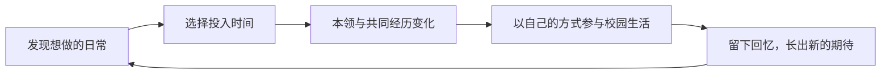

# 下一版 MVP 范围：中国，轻松的大学生活

2026-10-26。**四年完整范围仍为提案；v0.4 已将试玩修订为入学后三个月的连续日历；完整四年尚未实现。** 用户要求以快乐的大学生活为主轴，取代前一版毕业到求职提案。

## 方向与范围变化

用户原话：「求职吗，有点太苦了。能不能就是快乐的大学四年（也可能3年专科或者5年本科什么的都可以）生活可以怎么过」。据此，主线改为在大学几年中探索兴趣、结识同伴、参与日常，逐渐把校园过成熟悉的地方。职业准备不再承担主线；中国单国起步、角色成长、能力影响事件与未来国家内容扩展继续保留。

四年是首个制作样本，三年与五年说明学制可以有差异，不视作已承诺首版制作三套内容。完整四年的内容预算高于此前短片段。先前按约 24 次选择安排的预算，已被最新节奏反馈覆盖：日常应占大多数，只有特殊节点展开剧情。新的时间粒度与剧情预算待时间线样例确认，不靠增加空点击补时间感。

## 一句话玩法

发现一件想做的小事，留出时间参与，学到本领或留下共同经历；以后再遇见同一个地方、人物和校园活动时，能用新的方式参与，并自然产生下一次期待。

快乐来自发现、熟悉、成长和共同经历。生活保留有限时间的选择，不要求每次活动都兑现成能力收益，也不把错过自动算成损失。安静的独处与热闹的参与都能留下具体经历。

## 首版建议预算

| 项目 | 建议范围 |
| --- | --- |
| 背景 | 一座虚构中国校园、一个固定新生开局；不代表全国大学经历 |
| 学制 | 默认四年、8 学期；合并平静时间，不逐日排课 |
| 节奏 | 独立校园日历，近期重心持续作用；普通记录自动经过，特殊剧情按时间与条件出现，操作数待节奏样例确认 |
| 日常活动 | 兴趣、相处、探索三类；每次展示 2–3 件具体事情，不用三类抽象加点按钮替代生活 |
| 本领 | 2 项可成长本领；题材通过第一年样例确认，不默认玩家喜欢摄影或主持，不以固定职业称号收束 |
| 同伴 | 3 位贯穿人物，记录相识、共同做过的事与约定；不加好感度条或复杂关系网 |
| 校园节点 | 常规校园日历与特殊剧情分开；不再按每学期固定配额强制触发一场剧情，具体内容预算待样例确认 |
| 约束 | 有限时间；不另做资金、精力、考试压力或幸福分数管理 |
| 收束 | 完整经历日志与少量精选回忆分开；纪念册不再对每次日常强制发放物件，无人生排名 |
| 基础体验 | 克制像素文字界面、当前一局存档/恢复、重玩、事件与来源记录 |

本领和共同经历能触发特殊邀请，也能改变共同校园节点的参与方式。大家都会遇到新学期、校园节日或季节变化，玩家决定怎样参与；没有练某项本领也能继续生活。

## 大一的早期玩法样例

以下仅示意体验，不是已确认的兴趣题材或完整事件脚本。

眼前三选：「跟室友去社团开放日」「借台相机绕校园走走」「在宿舍张罗电影夜」。每件事都有当下的具体体验，而非先苦练再等回报：认识一个人、发现一个地方、一起笑过一场电影。

迎新活动照常到来。玩家可用之前学到的东西拍照、试着串场，也可和认识的人布置现场。亲自选择怎么参与；不由旁白替玩家自动包办全部工作、统一宣告成功。不同参与方式留下不同照片、物件或共同经历，后续会再遇见它们。

第二年，同一位伙伴来邀请你带新生。此时知道校园里哪条路好走、认识谁、愿意以什么方式参与，会改变可选做法。成长体现为自己能主动发起、知道怎样参与、与同伴渐渐默契，而非统一升级成负责人。

没有参加的活动可以通过同伴讲述或带回的照片出现，但记录必须明确「听说/看见」，不伪造自己参加过的经历。之后仍有重新加入、改变兴趣或安静生活的空间，不制造一次错过就失去一生机会的压力。

## 四年的节奏建议

- 大一：校园与人都陌生，尝试、认识、发现几个想再去的地方。
- 大二：开始有熟悉的安排和同伴，先前兴趣长出新的参与方式。
- 大三：把一两件自己在意的事做出来，也可以换一种过法；不强制人人发起活动或做作品。
- 大四：重逛熟悉的地方、兑现小约定，回看自己与伙伴怎样变化；毕业是纪念节点，不设就业成绩单。

这里的生活节奏不是固定成长任务。人物与校园有各自发生的事情，不能全都围着玩家能力达标后才出现。

## 三年、五年与其他国家

实现时保留学制年数、学年和学期的配置边界，避免把四年写死在调度与存档中。首版只写四年内容；三年、五年的六/十学期需要独立安排内容密度与节点，不直接删两轮或多循环两轮就称作已支持。不同学制的经历不排名。

国家扩展仍区分参考资料、校园生活内容、通用时间与成长规则。先完成中国样本，第二国加入时检验共用边界；不预建全球制度与概率引擎，不只换国家名称。

## 后置与超范围提示

求职主线、真实成绩与挂科模拟、完整课程表、毕业就业评级、家庭阶层、生活费与打工经济、精力/压力条、恋爱网、技能树、大量专业、随机灾难池、全球随机出生、sharing、真实在线玩家与排行均后置。

同时制作三/四/五年学制、第二个国家、第三项能力、第四位长期人物，或加入完整恋爱/经济循环，均超出这份建议预算，需要另行说明验证目的与工作量。

## 开发与验收

先写大一两个学期的完整纸面体验，约 6 次选择，验证人物、日常与后续是否值得期待；成立后再扩至同一条四年流程。先验证一年不改变四年 MVP 的目标，也不直接重写现有线上页面。

规则检查包括：成长确实改变参与方式；生活节点不全依赖升级；后续引用真实经历；未参加的活动不写成已参加；存档不重复结算。

乐趣验收观察：玩家是否因为期待某个人、地方或活动而想进入下一学期；是否能认出早期经历后来发生的变化；有没有自己想延续或改变的生活安排。能走完四年、记住余额或把能力点满，都不能单独证明体验成立。

相关诊断见 [设计复评](lead-game-design-review.md)，线上原型见 [v0.2 记录](mvp-minimal.md)。

## 已实现的大一验证片段 v0.3

用户要求先看试玩，当前实际交付为大一秋春两个学期，每学期两件日常加一个共同校园节点，共六次主要选择。采用「记录」「张罗」两项本领，阿禾/小满/林野三位同伴；三个日常备选旁，春季可因真实秋天经历多出一份邀请。共 14 种活动/参与方法，两次校园节点，实际选择形成六段回忆。

已实现人物共同经历查看、回忆弹窗、纪念册、存档恢复与重玩；旧版记录保留独立键。四年只作为背景与后续方向，本片段明确在大一结束。完整四年、三年/五年内容与其他国家均未宣称已支持。

规则与叙事共 22 项检查通过；436 个可达状态、264 条完整路线均能结束。是否轻松、有养成感、让人期待下一学期，需要用户试玩判断。

## 最新节奏纠偏，尚未实现

用户试玩后明确不喜欢每次选择都有成果，认为太刻意，期待大部分日常与少数特殊剧情节点，以及真实的时间线感觉。这覆盖本提案早期的「两次活动＋一个剧情」节奏，不通过继续扩写六段故事解决。原作公开脚本与运行对照、建议时间结构见 [1in8b 时间与节奏复核](one8b-time-rhythm.md)。本轮只复核与记档，线上仍为 v0.3。

## 已实现的节奏片段 v0.4

应用户要求调整试玩，将当前入口换成九月一日至十一月三十日的独立校园日历。四个持续重心，普通周记与季节记录自动经过；记录/张罗随实际天数渐熟，相识的人与两场条件剧情依赖实际投入和时间窗口，另有一场宿舍共同事件。剧情允许不参与，选择后直接写入生活记录，没有统一成果页或每次强制纪念物。持续室友相处与随心生活会改变共同剧情的叙事；不以技能总分、剧情全收集或毕业评级收束。

暂停、1/2/4倍速、快进至下个待答剧情、人物/成长查看、自主收藏、严格存档重放已实现。打开其他标签页、人物详情、重开确认会暂停；刷新停在保存日期。保留旧v3存档键，v4独立保存。当前测试为14项日历检查、三剧情27种选项组合，旧v3测试单列保留。浏览器走查覆盖自动推进、条件剧情、快进、拒绝参与、收藏视图结果可见、刷新恢复与十一月底结束。完整大学、其他国家与sharing仍后置。

## v0.5：让日常积累变成可做的新事

2026-10-27。用户反馈日历像挂机看日志，要求投入逐渐改变能做的事和会遇到的剧情，且最新日志在最上。范围继续保留九月至十一月、两项本领与三位人物；新增两件玩家主动发起的准备事项、两条后续剧情，不扩完整大学、经济或大型技能树。

记录/张罗按实际对应重心投入7/18/35天渐熟，面板展示具体新做法与下一阶段。入门可以主动开始组照/小放映，需再投入7天准备；换重心暂停进度、以后可继续，开始时不加点、不领奖。完成准备且达到第二阶段能力后，在对应时间窗口才可能发生照片墙/自办放映；第三阶段允许独立安排，第二阶段仍可合作，搁置也不判失败。保持普通日常为多数，不把每次日常都写成成长里程碑。

快进与自动推进在能力变化、准备完成或剧情时暂停，给玩家主动安排的机会。日志/收藏按最新在上显示；阅读旧记录保留锚点，选择结果回到最新记录。v4存档以原规则验真后接续到v5，保留日期、技能、文字、事件标识及收藏，原v4键不覆盖，不追写没做过的项目。26项规则检查覆盖两条养成链、能力参与门槛、准备暂停恢复、存档迁移与原日历路线。乐趣仍以新一轮试玩判断。

## v0.6：同样日常，因过去选择形成不同路线

2026-10-27。用户继续指出像等待天数解锁固定任务，要求早期选择改变之后的成长与剧情。保持两项基础本领，不加职业树或新阶段；在记录中区分观察/倾听，在张罗中区分内容/同伴。项目开头和四个原有剧情选择会改变接下来练什么，之后真正投入对应日常才增长相关经验。选择本身不直接加专长，也不倒填已有天数。

成长面板展示最近的做法、已学会什么与实际来源，可回看当时的选择；取消剩余天数倒计时。可以改变练法，旧经验保留；进行中的准备若采用另一种方法，会先暂停，用户可明确恢复原法或放下它。做成的东西保留当时的做法与文字快照，后来的转向不能改写过去。

照片墙/人物记录与自办放映/散场交流各为一组替代剧情，每组每局至多一场。定义增加两个变体，但实际每局仍最多原三场加两场后续。触发同时考察时间窗口、实际准备、当前练法与相关专长，不按一个通用熟悉度分数宣告全能。v4/v5存档严格验证接续，新方向不从旧历史猜测，原待答文案与门槛保留。

验收包含反事实双局：同样原始观察组照、同样散步天数，只改变湖边一次选择，继续同样投入后分别出现照片墙与人物记录；旧成品、总投入与基础熟悉度仍相同。社团同理验证帮忙/看片影响不同后续。39项检查覆盖因果分歧、不可倒填、周记来源、调整与暂停、互斥剧情及迁移，不以通过测试宣称乐趣已验证。

## v0.7：同伴怎样回应，也来自之前的相处

2026-10-28。用户期待涉及他人的选择有具体回应，且因数值与经历产生不同走向。继续保留三位人物、两项本领、三个月与每局最多五场剧情；不扩完整社交网、恋爱或好感经济。

人物回应读取选择前的两类事实：对应日常投入形成的熟悉程度，以及实际一起做过的事。小满更在意现场能否接住，林野更在意倾听与自己的拍摄边界，阿禾从平时是否聊得来接话。每个现有选项都有具体动作和对白变体，拒绝也有不同接法，但不统一扣分。回应写入事件，刷新和回看不会重新生成或随机翻转；之后的日常回响会继续引用真实来源。

分歧落实到后续行动：同样掌握内容编排，有过现场合作，小满才愿意让你先拿钥匙、带新同学开门接人；否则可以先与她搭档确认现场。早期选了看片，后来也可通过实际练习现场协调补上这份依据，避免一个早期选项成为唯一正确答案。个人完成准备不等于已经获得他人托付，照常搭档也不算较差结局。

选择后时间自动继续，回应留在页面供阅读，并保存在生活记录与人物最近相处中。连续同日剧情不会吞掉上一次回应。v6 及更早版本按冻结规则验真接续，保留原记录和已打开场景的选项；旧经历不补写从未出现过的回应。

## v0.8：可以主动找人，关系来自平时的往来

2026-10-28。用户希望主动聊天和约人，关系能逐渐养起来。首版增加六项主动相处：阿禾聊近况/一起吃饭、小满聊电影/一起试设备、林野聊这两天/沿湖拍照；保留原三位同伴、两个本领、三个月与原有剧情数量，不扩恋爱网、礼物经济或自由输入聊天。

点击人物后可查看下一段课余能做什么、对应日期和时间成本。一次相处让日期前进一天，替代那天的常规安排；基础本领、专长和项目不会同时免费推进，长期重心保留，之后自动继续生活。伙伴有自己的忙碌安排，同人往来需要留间隔，暂时约不上会先显示原因和下一可约日，关闭人物页不耗时间。

聊天逐渐熟悉，共同活动留下具体合作依据。连续相处会接续真实聊过、做过的事，第一次也留下可回看的细节；后续共同活动逐步形成分工默契。单纯聊天不替代处理现场的经验，后来主动交往也可以改变原有剧情的回应和可选分工。没有统一好感总分或每次颁奖。

主动相处与被动剧情共用事件记录和回应展示：行动后可自动继续，跨到新待答剧情时先保留刚才回应，再等玩家决定。旧版记录以冻结规则接续，日期、往来前的事实、已有回应与原待答选项保留，不补写未发生过的相处。

## v0.9：同伴也会主动来找你

2026-10-28。用户期待关系双向发展，熟悉之后不必一直由玩家点按钮。保留三个人、原六项相处和三个月范围；加入基于真实前史的回访与邀约，不扩消息聊天产品、恋爱网或新的大型剧情线。

同伴会在已有往来或共同经历后，隔一段日常主动接旧话、讲自己的近况，或问要不要一起吃饭、试设备、沿湖走。邀请引用真实发生的来源，按个人空闲日程和回访间隔出现；最多同时一份，新来信不暂停日历、不抢阅读焦点，也不在玩家刚相处完时立即返还一份奖励。单纯日历推进而从未相处，不会凭空获得密友邀约。

玩家可以接受、婉拒或收起晚点再看。接受才占一天课余并增加实际相处，记录明确是对方发起；婉拒和未排上不扣关系。稍后状态刷新后保留，来访可从人物页与日志回看。主动约了同一人时会同步处理旧邀约，避免已经见面仍挂着催约。接受时重查双方下一段课余与待答剧情，其他成长不额外结算。

普通自动时间持续，主动快进遇新邀请可以停下来查看。明确打开邀请细读时暂歇日历，合上后回到原节奏；约十天内未排上便静默归档，结束边界不会越过十一月底。v8及更早版按冻结规则接续，保留原回应、相处和待答选择；新邀请只从接续后的日常出现，不伪造旧来信。
