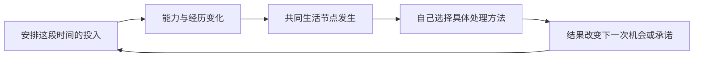

# 下一版 MVP 范围：中国，大学到初入职场

2026-10-26。**范围提案，尚未实现；只有国家方向、成长阶段与角色养成目标已获用户确认。** 当前线上仍为 v0.2「城南八周」，不是本提案。

## 已确认与本次建议

用户确认单国中国优先，阶段为「大学到初入职场：能力、人际和职业方向逐渐形成」，能力决定可以触发什么事件；流程走顺后，再通过参考与内容文件扩展国家。Sharing 继续后置。

本次建议将实际制作切片限定为「毕业前一学期到入职前三个月」。一套具体的虚构城市、学校与职场背景，不代表全中国学生。具体专业/行业尚未选定，首版只制作一组，先用事件样例确认题材吸引力。目标游玩时长约 10 分钟、8–10 次有效选择，均待试玩校准，不为凑时长填内容。

## 一句话玩法

安排有限的学习、实践与相处时间；在共同生活节点中亲自选择处理办法，让此前养成的本领与合作经历改变可行方法，再根据实际后果调整下一步方向。

能力同时影响特殊机会的出现和共同事件的处理方法。事件并非全部等待能力达标才发生；基础方案始终可继续。关键成本与条件在选择前说明，局面和新内容留给游玩发现。

## 制作预算

| 项目 | 本轮建议上限 |
| --- | --- |
| 地点与角色 | 1 套中国城市生活背景，1 名固定开局角色 |
| 阶段 | 毕业前一学期 → 第一份工作入职前三个月，合并平静时间 |
| 专业与职业 | 1 组专业/行业样本；同一领域里的职责倾向，不做多套完整职业线 |
| 能力 | 2 项：专业实践、沟通协作（暂定名称）；有实际用途才增长，不以刷满换职业证书为唯一目标 |
| 约束 | 有限时间/行动位；先不另加资金、精力或压力条 |
| 人际 | 2 位贯穿人物，例如项目同学、实习带教；记录合作与承诺，无好感度系统 |
| 主事件 | 3 个共同节点，每个 2–3 种具体处理方法；方法受能力及实际经历影响 |
| 回响内容 | 最多 6 段条件回响；至少一处改变后续可选安排或占用时间，不能全是回顾文案 |
| 操作预算 | 整局约 8–10 次有效选择，含日常投入与事件决定；不固定每阶段“练习一次＋过关一次” |
| 收束 | 1 个事实回顾：本领、做成的事、合作经历、职责倾向；不制作大量独立结局或人生排名 |
| 基础体验 | 克制的像素文字页面、当前一局保存/恢复、重玩、事件事实与来源记录 |

两项能力可通过学习、实际实践与合作获得。具体增减、门槛和成长速度由纸面样例校准；本提案不把旧版 0–4、两次解锁等参数自动带入。

## 三个共同节点

| 节点 | 玩家真正要决定什么 | 如何影响后续 |
| --- | --- | --- |
| 毕业项目展示 | 自己补齐关键演示、协调缩减范围，或寻求有代价的基础协助；不是点一下就自动完成全部工作 | 留下具体作品与协作事实；承诺可能占用下段时间，作品或合作经历可用于下一节点 |
| 实习中的岗位尝试 | 用已有作品承担专业工作，或用合作经历参与协调工作；仍需对眼前任务选择处理办法 | 真实试过的工作改变带教后续交付的责任，也让玩家发现自己想深入或补上的本领 |
| 入职后第一次独立任务 | 在明确目标与限制下，选择如何交付、协调或调整承诺；允许使用不同方法 | 展示较早决定的用途，留下实际责任与尚未完成的追求，再生成阶段回顾 |

这是节点结构，题目、人物和具体方案还需事件脚本，不冒充已完成内容。更高能力增加方法或减少特定代价，不能只换成同一结果的更高收入。合作路线不保证总比独立工作更好，也不把独立处理事后写成自私的惩罚。

## 后置

全球随机出生、不同国家制度、完整大学四年、完整职业生涯、多专业/多行业、真实招聘与录取概率、家庭阶层、恋爱网、好感度、技能树、背包经济、随机灾难池、大量结局、sharing、真实在线玩家与排行。

如果后续方案要求第三项能力、第二个行业、第三位长期人物，或新增资金/精力循环，就已超出此预算，需要明确说明增加的验证价值与工作量。

## 国家扩展窗口

只做中国内容，保留三类简单文件边界：参考资料及适用时间、国家/阶段内容与事件、通用时间与成长规则。事件使用稳定 ID，保存实际选择、能力条件、后果与来源。先不建设通用国家引擎；第二国加入时再检验哪些能共用、哪些要重写。

## 验收与开发顺序

先写一个贯穿的纸面样例（准备、事件处理、后续安排），观察这段体验；通过后再填齐三个节点并实现完整试玩。这里的三次选择是验证手段，不是把正式游戏缩回三回合。

**规则验收：** 不同能力确实开放不同方法；基础方案可继续；此前选择至少改变一处后续安排或代价；存档不漏结算、不虚构经历；各节点能走完。

**乐趣验收：** 玩家主动想看下一幕；因亲历的结果改变下一步培养安排；重玩时有一个自己想试的不同做法；能指出角色现在能做、之前做不到的事。能解释规则但只是在点完流程，仍不算通过。小样本只指导下一轮修改，不当作广泛玩家结论。

相关诊断见 [设计复评](lead-game-design-review.md)，线上原型历史范围见 [v0.2 记录](mvp-minimal.md)。
