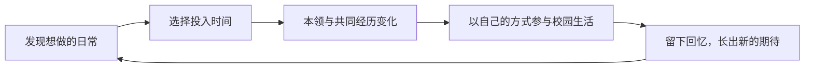

# 下一版 MVP 范围：中国，轻松的大学生活

2026-10-26。**四年完整范围仍为提案；v0.3 大一试玩已实现，但节奏已被最新反馈否定，需要先修订时间模型。** 用户要求以快乐的大学生活为主轴，取代前一版毕业到求职提案。

## 方向与范围变化

用户原话：「求职吗，有点太苦了。能不能就是快乐的大学四年（也可能3年专科或者5年本科什么的都可以）生活可以怎么过」。据此，主线改为在大学几年中探索兴趣、结识同伴、参与日常，逐渐把校园过成熟悉的地方。职业准备不再承担主线；中国单国起步、角色成长、能力影响事件与未来国家内容扩展继续保留。

四年是首个制作样本，三年与五年说明学制可以有差异，不视作已承诺首版制作三套内容。完整四年的内容预算高于此前短片段。先前按约 24 次选择安排的预算，已被最新节奏反馈覆盖：日常应占大多数，只有特殊节点展开剧情。新的时间粒度与剧情预算待时间线样例确认，不靠增加空点击补时间感。

## 一句话玩法

发现一件想做的小事，留出时间参与，学到本领或留下共同经历；以后再遇见同一个地方、人物和校园活动时，能用新的方式参与，并自然产生下一次期待。

快乐来自发现、熟悉、成长和共同经历。生活保留有限时间的选择，不要求每次活动都兑现成能力收益，也不把错过自动算成损失。安静的独处与热闹的参与都能留下具体经历。

## 首版建议预算

| 项目 | 建议范围 |
| --- | --- |
| 背景 | 一座虚构中国校园、一个固定新生开局；不代表全国大学经历 |
| 学制 | 默认四年、8 学期；合并平静时间，不逐日排课 |
| 节奏 | 独立校园日历，近期重心持续作用；普通记录自动经过，特殊剧情按时间与条件出现，操作数待节奏样例确认 |
| 日常活动 | 兴趣、相处、探索三类；每次展示 2–3 件具体事情，不用三类抽象加点按钮替代生活 |
| 本领 | 2 项可成长本领；题材通过第一年样例确认，不默认玩家喜欢摄影或主持，不以固定职业称号收束 |
| 同伴 | 3 位贯穿人物，记录相识、共同做过的事与约定；不加好感度条或复杂关系网 |
| 校园节点 | 常规校园日历与特殊剧情分开；不再按每学期固定配额强制触发一场剧情，具体内容预算待样例确认 |
| 约束 | 有限时间；不另做资金、精力、考试压力或幸福分数管理 |
| 收束 | 完整经历日志与少量精选回忆分开；纪念册不再对每次日常强制发放物件，无人生排名 |
| 基础体验 | 克制像素文字界面、当前一局存档/恢复、重玩、事件与来源记录 |

本领和共同经历能触发特殊邀请，也能改变共同校园节点的参与方式。大家都会遇到新学期、校园节日或季节变化，玩家决定怎样参与；没有练某项本领也能继续生活。

## 大一的早期玩法样例

以下仅示意体验，不是已确认的兴趣题材或完整事件脚本。

眼前三选：「跟室友去社团开放日」「借台相机绕校园走走」「在宿舍张罗电影夜」。每件事都有当下的具体体验，而非先苦练再等回报：认识一个人、发现一个地方、一起笑过一场电影。

迎新活动照常到来。玩家可用之前学到的东西拍照、试着串场，也可和认识的人布置现场。亲自选择怎么参与；不由旁白替玩家自动包办全部工作、统一宣告成功。不同参与方式留下不同照片、物件或共同经历，后续会再遇见它们。

第二年，同一位伙伴来邀请你带新生。此时知道校园里哪条路好走、认识谁、愿意以什么方式参与，会改变可选做法。成长体现为自己能主动发起、知道怎样参与、与同伴渐渐默契，而非统一升级成负责人。

没有参加的活动可以通过同伴讲述或带回的照片出现，但记录必须明确「听说/看见」，不伪造自己参加过的经历。之后仍有重新加入、改变兴趣或安静生活的空间，不制造一次错过就失去一生机会的压力。

## 四年的节奏建议

- 大一：校园与人都陌生，尝试、认识、发现几个想再去的地方。
- 大二：开始有熟悉的安排和同伴，先前兴趣长出新的参与方式。
- 大三：把一两件自己在意的事做出来，也可以换一种过法；不强制人人发起活动或做作品。
- 大四：重逛熟悉的地方、兑现小约定，回看自己与伙伴怎样变化；毕业是纪念节点，不设就业成绩单。

这里的生活节奏不是固定成长任务。人物与校园有各自发生的事情，不能全都围着玩家能力达标后才出现。

## 三年、五年与其他国家

实现时保留学制年数、学年和学期的配置边界，避免把四年写死在调度与存档中。首版只写四年内容；三年、五年的六/十学期需要独立安排内容密度与节点，不直接删两轮或多循环两轮就称作已支持。不同学制的经历不排名。

国家扩展仍区分参考资料、校园生活内容、通用时间与成长规则。先完成中国样本，第二国加入时检验共用边界；不预建全球制度与概率引擎，不只换国家名称。

## 后置与超范围提示

求职主线、真实成绩与挂科模拟、完整课程表、毕业就业评级、家庭阶层、生活费与打工经济、精力/压力条、恋爱网、技能树、大量专业、随机灾难池、全球随机出生、sharing、真实在线玩家与排行均后置。

同时制作三/四/五年学制、第二个国家、第三项能力、第四位长期人物，或加入完整恋爱/经济循环，均超出这份建议预算，需要另行说明验证目的与工作量。

## 开发与验收

先写大一两个学期的完整纸面体验，约 6 次选择，验证人物、日常与后续是否值得期待；成立后再扩至同一条四年流程。先验证一年不改变四年 MVP 的目标，也不直接重写现有线上页面。

规则检查包括：成长确实改变参与方式；生活节点不全依赖升级；后续引用真实经历；未参加的活动不写成已参加；存档不重复结算。

乐趣验收观察：玩家是否因为期待某个人、地方或活动而想进入下一学期；是否能认出早期经历后来发生的变化；有没有自己想延续或改变的生活安排。能走完四年、记住余额或把能力点满，都不能单独证明体验成立。

相关诊断见 [设计复评](lead-game-design-review.md)，线上原型见 [v0.2 记录](mvp-minimal.md)。

## 已实现的大一验证片段 v0.3

用户要求先看试玩，当前实际交付为大一秋春两个学期，每学期两件日常加一个共同校园节点，共六次主要选择。采用「记录」「张罗」两项本领，阿禾/小满/林野三位同伴；三个日常备选旁，春季可因真实秋天经历多出一份邀请。共 14 种活动/参与方法，两次校园节点，实际选择形成六段回忆。

已实现人物共同经历查看、回忆弹窗、纪念册、存档恢复与重玩；旧版记录保留独立键。四年只作为背景与后续方向，本片段明确在大一结束。完整四年、三年/五年内容与其他国家均未宣称已支持。

规则与叙事共 22 项检查通过；436 个可达状态、264 条完整路线均能结束。是否轻松、有养成感、让人期待下一学期，需要用户试玩判断。

## 最新节奏纠偏，尚未实现

用户试玩后明确不喜欢每次选择都有成果，认为太刻意，期待大部分日常与少数特殊剧情节点，以及真实的时间线感觉。这覆盖本提案早期的「两次活动＋一个剧情」节奏，不通过继续扩写六段故事解决。原作公开脚本与运行对照、建议时间结构见 [1in8b 时间与节奏复核](one8b-time-rhythm.md)。本轮只复核与记档，线上仍为 v0.3。
