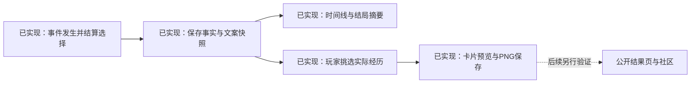

# 人生事件记录：基本能力与扩展参考

状态：中国完整一生的最小记录能力已在 `web/dist/life/` 实现；下文另保留更完整玩法的扩展参考。更新于 2026-10-28。

**现行范围以 [中国完整一生 MVP](china-life-mvp.md) 为准，内容基准是 [两条纸面试玩](china-life-paper-playthroughs.md)。** 最少保存当前人生、时间、人物与地点事实、待答选择、已经结算的经历及来源。下文的随机数状态、年度标记、延期队列和持续效果属于扩展参考，不要求首版全部实现。

简版分享卡已纳入首版：从本局实际经历中挑选内容，可填写个人感想、预览并保存图片。公开结果页、站内社区、服务端图片存储和传播归因仍后置。

## 1. 基本记录能力

采用 **当前人生状态 + 结构化事件记录**。

当前状态回答“现在几岁、从事什么工作、与谁生活”；事件记录回答“什么时候发生了什么、玩家选了什么、实际得到什么结果”。只保留当前状态无法追回已经过去的升学、迁居、职业转折等经历。

当前存档采用 `state` 与卡片界面状态；`state` 保存 `age`、`facts`、`processed`、`pending`、`log`、`choices` 和受限 `commands`。`log` 留下当时的年龄、类别、标题、正文及可选人物对白或回忆文字；选择另外保存事件ID、选项ID和年龄。每条记忆候选引用实际日志的 `sourceId`，不从结束状态倒造过去。

恢复时，引擎从初始状态重放有限的开始、推进与选择命令，核对保存的事实、文字快照和待答场景，拒绝被改写的存档。这是本地确定性规则的核验方式，没有消息队列或分享后端；下文更完整的事件字段仍是扩展提案，并非都已落地。



## 2. 记录边界

- 保存玩家实际看到的已发生事件，以及已结算的选择与结果。动画、每帧状态和无事发生的年份不必成为事件。
- 同一种事件可以发生多次，每次有不同的实例 ID。`eventType` 表示类别，不能代替实例 ID。
- 事件模板描述“可能发生什么”；事件记录保存“这一生实际发生了什么”，包括当时抽到的名称、地点和实际结果。
- 事件文案与结构化事实都保存。事实用于筛选和重新排版，文案快照保留当时体验。
- 保存来源和亲历方式。B收到母亲拍摄的关门视频，不记为本人当时在场；周舟独自完成的采录也不能记成玩家完成。
- 区分素材存在、作品完成、提交、入选与展出；一次参与不自动完成后续阶段。居住和关系的历史也不能仅由结尾状态倒推。
- 世界外部变化与玩家选择的来源分开。老街改造不会被写成离家选择造成的后果。
- 卡片选中的记录、显示文字与可选玩家感想分别保存，便于重看；没有发生的事情不能靠结尾生成补齐，不自动评价最优人生或替玩家写真实感受。
- 普通记录不都需要变成精选内容。默认候选应可替换、删除，不把“有记录”当成已经分享。

## 3. 较完整玩法的字段参考

以下字段名是历史扩展提案，尚未定义为最终代码接口，也不是中国完整一生MVP必须全部实现的字段清单。只有加入相应系统后才启用对应字段。

### 人生存档层

| 字段 | 用途 |
| --- | --- |
| `schemaVersion` | 识别存档结构，并支持以后迁移 |
| `lifeId` | 区分不同人生 |
| `rulesVersion` / `datasetVersion` | 记录使用的规则与数据版本，避免用新规则解释旧结果 |
| `seed` | 辅助调试；不能替代玩家选择记录 |
| `randomState` | 当前随机数状态；恢复时从当前位置继续，不重新抽取候选与结果 |
| `lastSettledAge` | 最后结算的年龄/年度，避免刷新后重复执行年度变化 |
| `eventProgress` | 已抽出的可选候选年龄/结果、触发次数与过期状态，避免恢复时重新安排事件 |
| `currentState` | 当前可继续游戏的状态 |
| `pendingDecision` | 仍在等待玩家回答的事件；不存在时为空 |
| `pendingOutcomes` | 已安排但尚未到期的课程完成、状态反馈等后果；带来源、条件和处理状态 |
| `activeModifiers` | 有期限或绑定岗位/活动的持续效果，包含起止时间和失效条件 |
| `events` | 已发生、已结算的事件，按稳定顺序排列 |

### 每次事件

| 字段 | 最小含义 |
| --- | --- |
| `id` | 在这一生内稳定且唯一的事件实例标识 |
| `sequence` | 确定先后顺序，支持同一年多件事 |
| `type` / `templateVersion` | 类别与当时模板版本 |
| `definitionId` / `phase` | 对应目录定义与阶段，如 E09 的报名/完成；同一主题可输出不同实际记录 |
| `age` | 发生时年龄；使用具体年代时另存 `year` |
| `facts` | 人物、地点、触发背景、选择与实际结果等结构化事实 |
| `textSnapshot` | 当时展示给玩家的文字 |
| `tags` | 由类型决定的少量标签，如 `education`、`migration`、`milestone` |
| `sourceEventIds` | 有明确来源时关联过去事件；外部随机冲击不假装由上一次选择造成 |

有选择的事件在 `facts` 中保存选项 ID、当时选项文字和已结算结果；没有选择的事件不需要伪造一个选项。仅保存与该事件有关的结果或变化，无需复制整个状态对象。

人物 ID 可以用来关联其他记录，但关键展示信息也要保存当时值。例如旧事件中的配偶姓名、关系和居住地不能只读多年后已经改变的当前状态。

## 4. 一条例子

以下为虚构存档片段，省略了其他状态和更早的记录；没有采用真实奖学金数据，也不表示已实现。

```json
{
  "schemaVersion": 1,
  "lifeId": "life_demo_001",
  "rulesVersion": "prototype-1",
  "datasetVersion": "sample-1",
  "seed": "demo-seed",
  "randomState": "opaque-demo-state",
  "lastSettledAge": 18,
  "currentState": {
    "age": 18,
    "educationRoute": "higher",
    "enrollmentStatus": "active"
  },
  "pendingDecision": null,
  "pendingOutcomes": [
    {
      "id": "outcome_001",
      "sourceEventId": "event_0042",
      "dueAge": 22,
      "kind": "education.complete",
      "status": "pending",
      "requires": {
        "educationRoute": "higher",
        "enrollmentStatus": "active"
      }
    }
  ],
  "activeModifiers": [],
  "events": [
    {
      "id": "event_0042",
      "sequence": 42,
      "type": "education.path_chosen",
      "definitionId": "E05",
      "phase": "chosen",
      "templateVersion": 1,
      "age": 18,
      "year": 2044,
      "facts": {
        "school": {
          "id": "school_demo_01",
          "name": "示例大学"
        },
        "choice": {
          "id": "accept",
          "label": "接受奖学金"
        },
        "outcome": {
          "enrolled": true,
          "fundingType": "full_scholarship"
        }
      },
      "textSnapshot": "18岁，你接受了全额奖学金，进入示例大学。",
      "tags": ["education", "milestone"]
    }
  ]
}
```

首版可以按事件类型或标签找到实际经历，再用事实生成卡片。历史例子中的 `tags`、`facts` 与 `textSnapshot` 说明这类用途，不要求通过重跑人生恢复分享内容。

## 5. 写入、恢复与版本

1. 需要选择的事件先保存到 `pendingDecision`。刷新后继续同一个待答事件。
2. 结算选择后，更新当前状态、追加已发生事件、清除待答事件，并将这些内容作为同一次存档提交。
3. 事件实例 ID 用于防止重复结算：刷新或重复点击不能再次发奖学金、改变状态或追加同一事件。
4. 存档成功后再标记已保存。写入失败需要保留内存数据并反馈，不静默假装保存成功。
5. 增加字段时提供旧版本默认值或迁移；缺失的旧事实保持未知，不通过猜测补成“历史”。
6. 到期后果、当前随机数状态和年度结算标记随同一次存档保存。先校验条件再发资格/待遇，结算后标记已处理；失效时明确取消，不能每年重新发现并重复执行。

本轮固定样本按年龄与前史结算已有事件，保留来源及实际结果即可；只有出现并行课程、多种限期效果等实际需求时，才引入相应队列和持续效果。复杂调度与岗位失效规则见已后置的 [核心玩法规格](gameplay-v0.1.md)。

事件事实与文案一旦结算便保留当时值。玩家挑选记录、修改分享标题或删减展示内容属于另外的表现数据，不直接改写已经发生的事实。

## 6. 首版与后续能力的边界

| 能力 | 范围 | 记录基础 |
| --- | --- | --- |
| 玩家挑选、删减卡片中的经历 | 首版 | 稳定人生与事件标识、选中项及来源 |
| 简版分享卡预览与图片保存 | 首版 | 已发生事实、显示文案、可选玩家文字 |
| 自动挑出亮点或生成更长的人生小传 | 后续 | 事件类型、时间、事实与标签 |
| 更多图样、排版和多语言 | 后续 | 同一事实可重新排版，原有文字保留 |
| 更复杂的事件链解释 | 后续 | 复用来源引用，按实际玩法增加后果队列与多原因解释 |
| 公开分享页面、服务端图片存储、链接归因 | 后续 | 另行实现公开快照、访问端点与发布规则 |

首版不需要自动亮点评分或公共发布许可系统。玩家在本地选择卡片内容并预览、保存，不意味着自动上传或发布。

## 7. 扩展兼容示例

以下保留较完整玩法的兼容性示例，奖学金、退学、更名等系统未纳入当前范围。当前已有的迁居、关系变化和分享事实保真，仍按中国完整一生MVP验收；不要求建设通用年度调度系统。

- 一个人在 18 岁接受奖学金，后来退学，旧记录仍能准确展示这次获得奖学金的经历。
- 同年先迁居再换工作，时间线和筛选结果的顺序稳定。
- 人物之后更名或关系改变，不会让旧事件的人名和关系悄悄变成当前值。
- 等待选择时刷新不会跳过事件；结算后刷新不会重复应用结果。
- 修改事件模板的措辞，不会自动重写旧存档的当时文案。
- 从旧人生中按标签取出特殊事件，无需解析自然语言日志，也无需重新抽样。

设计建议来源：本项目对未来特殊事件分享的需求分析；这是拟采用的独立设计，不是对原站内部架构的描述。
