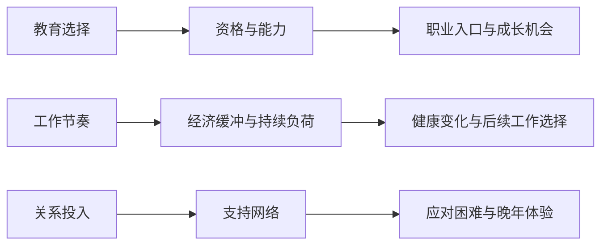
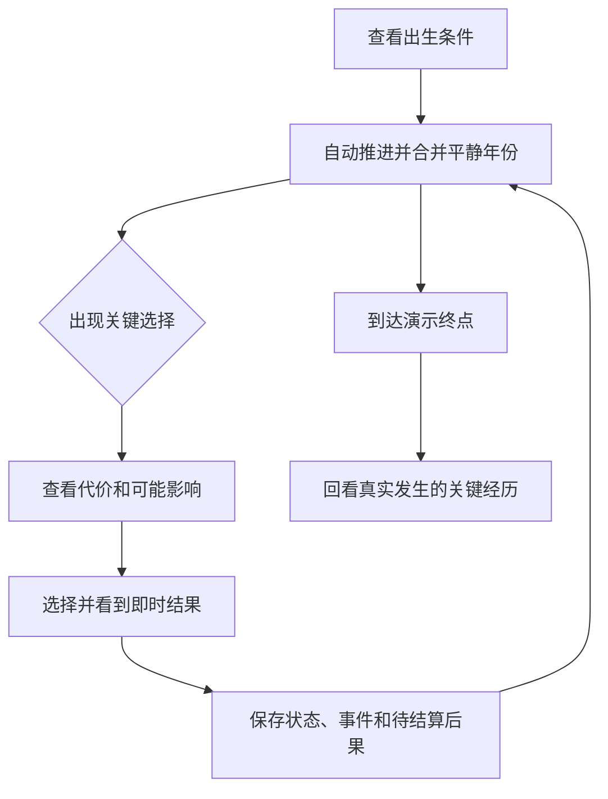

# 核心玩法规格 v0.1

状态：待讨论提案，尚未实现。日期：2026-10-26。

用户已确认：sharing 后置，人生中的特殊事件需要持久保留。本规格进一步收敛首版玩法；国家数量、事件预算、结束方式和参数仍是设计建议，不代表已获最终确认。

## 1. 一句话玩法

随机获得一组出生条件，在少数人生节点做取舍，看到选择怎样改变后续机会，并在结局中回看实际发生过的关键经历。

首版重点验收三条链：

这些是本项目拟实现的游戏规则，不是原站内部机制，也不是现实因果关系的统计证明。

## 2. 明确的范围预算

| 项目 | 首版边界 |
| --- | --- |
| 语言与平台 | 简体中文，桌面和手机浏览器；无需账号 |
| 出生样本 | 5 个国家配置位，具体名单在数据核验后确定；3 档家庭经济缓冲 |
| 国家对玩法的作用 | 展示已核验的背景信息；未核验的国别规则不进入模拟。当前因果链主要由家境、选择和模型事件形成 |
| 家庭与关系 | 家境只决定经济起点；关系支持独立初始化。只模拟一位重要他人，关系可为朋友或伴侣 |
| 年龄推进 | 内部按年结算，界面合并平静年份；关键选择暂停，支持暂停和继续 |
| 体验时长 | 目标约 3–5 分钟，不把个人阅读速度作为硬性验收；复杂分支可更长 |
| 事件库 | 20 个事件定义，含自动事实、选择、反馈和生命周期事件；不要求每局全部触发 |
| 决策密度 | 5 个常规决策、1 个条件职业成长决策、最多 5 个条件决策；每局 5–11 次，常见目标 6–9 次 |
| 职业 | 基础、技能、专业 3 类入口；稳定与成长 2 种初期节奏；最多一次职业成长机会（晋升或内部转岗）和一次职业受挫 |
| 经济 | 使用“可支撑几个月基本生活”的缓冲；不做实际货币、税、借贷、投资、房产与资产市场 |
| 健康 | 影响工作负荷与晚年状态；不模拟具体疾病、治疗方案和真实死亡概率 |
| 终点 | 建议统一在 80 岁结束演示，明确写“本次模拟到此结束”；不是预测死亡年龄 |
| 结局 | 从已有记录生成 3–5 个关键经历与状态概览，不按收入给人生排名 |
| 存档 | 当前人生与最近 10 段人生，本地保存；带版本、事件事实、待答选择和待结算后果 |
| 页面 | 出生信息、人生过程、结局 3 个主界面；历史记录作为抽屉或列表 |

常规决策为 E03、E05、E08 的首次入职、E10 和 E18。E18 不具备轻工作条件时仍可选择退休生活重心，不要求必须有工作。E11 为条件职业成长决策；E09、E12、E14、E15、E17 为最多各一次的条件决策。再就业结果使用 E08 的自动模式，不追加一次决策。

### 最大的两项取舍

1. **首版不验证国别机会差异。** 国家统计说明与游戏模型分开显示；不得把统一游戏规则描述成某国真实制度。国别数据与规则的映射经过核验后再接入。
2. **首版不验证真实寿命分布。** 固定终点方便覆盖中晚年事件。死亡与生命表以后通过独立结束策略扩展，不能用“平均寿命附近随机一个数”冒充真实风险。

## 3. 玩家一次怎样玩

- 每年最多出现一个需要玩家回答的事件；同年可先显示多个自动结果。
- 决策卡说明眼前代价和影响方向，例如“晚几年开始工作，完成后有专业岗位资格”。不展示未经验证的现实成功率。
- 不可选项显示具体原因和所需条件；每个决策至少有一条可行路径。
- 选择后显示实际变化。延迟结果到期时指出关联的过去选择；随机外部冲击不伪装成玩家选择的惩罚。
- 首版不做“每年重心”面板，避免 80 次重复操作。持续影响由已选择的工作节奏和临时活动形成。

每个选择至少改变一种后续事实：可达事件或资格、方案的实际代价、持续一段时间的状态趋势，或具体人物关系。只改一行文案或加一个不再使用的数值，不算完整后果。关系身份也可以是玩家自身偏好的表达，不强制每个身份选择都有更高收益。

## 4. 最小状态

| 状态 | 含义与使用 |
| --- | --- |
| 健康 `health` | 0–100；约束高负荷工作和晚年活动；不是生存概率 |
| 能力 `skill` | 0–100；影响资助候选、岗位资格和晋升机会；首版只做一个通用维度 |
| 关系支持 `support` | 0–100；影响遇到职业受挫时可获得的帮助及关系反馈；未婚不等于支持低 |
| 经济缓冲 `bufferMonths` | 非负数，以生活月数计；决定能否负担课程、培训或协调照顾 |
| 教育进度 | 路线、状态、开始年龄、计划完成年龄、资助是否使用 |
| 工作进度 | 稳定岗位实例 ID、职业入口、节奏、等级、任期、高负荷累计年数 |
| 重要他人 | 稳定人物 ID、当时姓名、朋友/伴侣关系；首版不构建完整家庭树 |

年龄、出生地、当前居住地、规则版本等属于身份或运行状态，不增加为玩家数值条。出生地与居住地分别保留，首版不搬迁；以后迁居不会覆盖出生事实。

家庭经济缓冲与关系支持独立初始化，避免默认“经济困难就缺少关爱”。性别首版只用于身份描述，不暗中施加未经核验的机会系数。

### 第一轮调参的演示基线

以下全部是游戏参数建议，与现实金额、医学或国家统计无对应关系；在独立参数表中实现，试玩后可调，不写死在文案里。

- 家庭经济缓冲可从 2 / 6 / 12 个月起步；初始支持独立抽取或采用同一基准。
- 基础、技能、专业工作每年净增缓冲可先用 1 / 1.5 / 2 个月。日常基本生活已在净值中简化处理。
- 成长型首岗前 3 年每年少存 1 个月、能力增长更快；3 年后额外代价到期。稳定型较早积累缓冲。
- 付费选项先检查余额，余额不足不允许扣成负数。职业受挫消耗缓冲时，零缓冲进入简化的缩减开支状态，仍保留基础工作路径；不自动生成债务、死亡或永久无法行动。
- 职业负荷的代价逐年结算；健康反馈只报告已累计的结果，避免同一份代价被再次扣除。

具体增减数值与随机权重在首个可玩切片中校准；本轮先固定各选项的代价、作用对象、持续时间和后续门槛。

## 5. 三条必须成立的玩法链

### 教育与职业

18 岁分流为：尽早工作、2 年职业训练、4 年继续教育。

- 尽早工作先获得一笔收入，19 岁进入首次正式求职；较早积累工作经验和缓冲。
- 职业训练在 20 岁完成，增加技能类岗位资格；继续教育在 22 岁完成，增加专业类岗位资格。
- 完成是已选择路线的到期后果；不能在 18 岁选择升学后立刻发放毕业资格。
- 17 岁的资助只是带有效期、覆盖范围和额度的机会。18 岁选择对应路线才实际使用，选择就业则过期。不能重复入账或变成永久收入。
- 资助考虑资金缺口、学习基础及模型机会；12 岁一次选择不能永久决定全部教育和职业可能。在职学习仍可帮助较早就业的人进入技能路线。
- 资助与余额不足时，继续教育可能暂不可负担，但尽早工作始终可选。选择受限需要给出原因。
- E09 完成后若能力达标，获得技能类岗位资格；E11 可以提供内部转入技能岗位的机会，无需先遭遇失业。原有专业教育门槛仍保留，不把短期培训写成大学学历。

### 工作与健康

稳定/成长型首岗 → 能力与缓冲积累 → 晋升资格 → 接受更多责任或维持节奏 → 持续负荷 → 健康警讯与两年后反馈。

- 晋升需要资格和经历，不直接由一次按钮决定。符合条件才出现真实机会；没有机会时不能显示虚构的“已拒绝晋升”。
- 接受晋升可增加收入与负荷。降低负荷会损失部分增量收入，同时改变之后的状态趋势。
- E15 的降低负荷持续到下一次主动改变工作安排或退休；“维持当前安排，两年后看反馈”不会在反馈时自动恢复基础节奏。两年是反馈期限，不是额外收入的截止日。
- 健康过低时高负荷方案关闭；如果已经处于高负荷，年度检查会降低负荷并同步调整相应收入，记录实际变化，仍允许较低负荷或退休路径。
- 职业受挫是外部冲击，不能仅因为玩家没有选学习、没有加班或做了某个社会选择就强制触发。

### 关系与应对困难

投入相处 → 形成朋友或伴侣关系 → 维系或忽视 → 支持状态变化 → 受挫时获得求职信息/较低恢复成本 → 晚年不同体验。

- 只模拟一位重要他人。选择“保持朋友”也能形成长期支持；不把伴侣路线设为唯一好结局。
- 一次关系摩擦不直接判定分手或离婚。其结果先作用于支持与相处节奏。
- 亲近的人需要帮助时，投入时间与协调其他帮助都有代价；付出较多不自动换取现金奖励。
- 支持只能通过明确事件改变恢复条件，不能每年凭空增加钱。

## 6. 年度调度与延迟后果

- 自动后果先于同年求职：20/22 岁毕业后才能生成有对应资格的岗位。
- 优先级建议：必经节点 > 需要应对的状态/外部冲击 > 关系事件 > 成长机会。毕业和已承诺的后果不能被普通机会挤掉。
- 决策在年龄窗口内可以延期；展示前重查条件。窗口结束或条件失效时取消并保留调试原因，不悄悄强制发生。
- 可选随机事件的候选年龄与抽样结果需要持久保存，不因刷新或重新渲染反复抽取。
- E15 最迟 58 岁出现，反馈最迟 60 岁到期；退休不能吞掉同年的反馈。
- E12 最迟 50 岁出现，转训最多 1 年；首版不处理临近终点才开始的长课程。
- 一局最多一次职业受挫、一次职业成长机会（晋升或内部转岗）、一次重要关系邀请，避免额外系统循环膨胀。
- 到达终点后停止年龄推进，将未发生的后果标为因人生结束而取消，不能把它们补写为已经完成的经历。

每个延迟后果保存：`id`、`sourceEventId`、`dueAge`、`kind`、已承诺的参数、继续成立的条件、取消/过期规则与处理状态。结果有随机部分时明确它在何时抽取并保存，不能刷新后重抽。

工作相关后果绑定 `employmentId`。离开旧岗位时清理旧岗位的奖金、负荷和晋升安排；新工作不继承已失效的待遇。学习、照顾等持续效果分别绑定适当的活动或人物，不笼统绑定到职业。

## 7. 预留的扩展窗口

| 未来能力 | 首版保留的接口或数据 |
| --- | --- |
| 新事件、特殊经历 | 事件定义与发生记录分开；稳定 ID、条件、选项、标签、次数和窗口 |
| 多年课程、连锁选择 | 明确的待结算后果，记录来源事件、到期时间与取消条件 |
| 国别差异与数据更新 | 出生/居住地 ID、独立背景配置、数据来源状态与版本 |
| 更细的职业技能 | 首版能力放在可扩展的技能结构中；不增加尚未使用的数值条 |
| 家庭与迁居 | 人物引用、当时关系/地点快照；不提前建家庭树、地图或移民制度 |
| 真实寿命模拟 | 独立结束策略；v0.1 用固定演示终点，以后替换时保留规则版本 |
| 分享与人生小传 | 结构化事实、选择、实际结果、文案快照和关联事件 ID |
| 存档与调试 | `schemaVersion`、规则/数据版本、初始 seed 和当前随机数状态、待答/待结算状态 |

只实现本轮需要的条件比较、数值增减、状态设置、限期持续效果和后果安排。首版不做通用脚本语言、插件系统、消息队列、完整事件溯源或任意职业模拟器。

## 8. 验收场景

1. 同样家境的三条教育路线，开始工作的年龄、资格、收入轨迹确实不同。
2. 获得资助但选择就业，不能把资助当现金花掉；使用后不能重复领。
3. 能力足够但无专业教育资格的人可以走技能路线，不凭空获得专业资格；在职学习保留成长空间。
4. 高负荷工作连续数年后出现反馈；调整节奏后，后续变化与继续高负荷不同。
5. 同一次外部职业冲击下，高低缓冲与不同支持状态改变可行方案或恢复成本；不改变冲击是否“应当发生”的道德解释。
6. 转训后可能取得更好的资格，但不保证更好的岗位；没有合适岗位时保留基础工作路径。
7. 保持朋友与建立伴侣两条路线都能形成长期支持；后续事件引用同一位已存在的人。
8. 同年完成学业、产生求职机会和其他随机候选时，先完成学业，最多弹一个决策，其他按规则延后或过期。
9. 等待选择、结算后、到期后果处理后分别刷新，均不漏记录、不重抽、不重复扣款或发资格。
10. 结局展示的每一件“关键经历”都能追溯到已发生的事件实例；80 岁结束不被描述成真实死亡预测。

每个事件定义至少有一条可达的人工场景。不能仅靠随机运行很多次来碰运气确认覆盖。

## 9. 实现顺序

先用一个已核验背景配置跑通 E01 → E02 → E03 → E05 → E07/E08 → E18 → E20，再补教育资助、职业/健康/关系链，最后扩到 5 个背景配置并完成全部目录验收。这个顺序是开发切片，不改变最终首版范围。

完整清单与每项选择见 [事件目录 v0.1](event-catalog-v0.1.md)。持久化设计见 [事件记录设计](event-records.md)。
