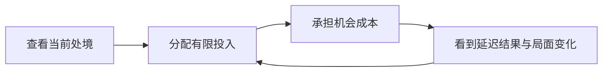

# Lead Product Analyst 独立分析：加入实际游玩反馈后的修正

2026-10-26。独立提案，未确认、未实现，不替换当前 MVP。依据为用户自述、现有方案与原站公开说明；不代表广泛玩家研究。

## 修正结论

**当前最有根据的主假设是：保留经营感，让不同局面产生真实取舍，改善多局选择趋同。** 这优先于我上一次推荐的短人生叙事。此前把未知感与人物回响视为主要价值，依据不足；现在不应继续维护这个预设。

“经营感”是用户对体验的描述，还不能直接等同于“用户想做深度经营游戏”。推荐先验证一个很小的经营循环，而非立即加入多套数值和系统。

## 新证据与边界

| 用户提供的信息 | 证据性质 | 当前能说明什么 |
| --- | --- | --- |
| 玩到了经营感；几次之后觉得选择差不多 | 实际游玩的直接自述 | 经营与多局取舍值得优先分析，但“差不多”的具体原因待拆解 |
| 丰富的 sharing 模板让他印象深刻 | 信息/视觉印象 | 模板选择可能有价值，不能推定已经选择、导出或发布过 |
| 同时有多少人在玩、他们的进度很有趣 | 信息印象 | 共同在场与比较可能吸引人，不能推定它已改善游玩或重开 |

用户还特别说明后两者来自看到的信息。当前不把“印象深刻”升级为已验证的使用价值。Sharing 仍按先前决定后置。

“并行人生”还需区分真实在线玩家、模拟同伴和历史人生；尚未核实用户具体指哪一种。原站首页的并行呈现可作机制参考，但不能因此认定其全部都是实时玩家进度。[官方首页](https://1in8b.life/en/)

## 为什么两次固定分支仍然别扭

它证明了前一选项能解锁后一选项，却删掉了经营所需的资源分配、机会成本和局面判断。玩家主要辨认路线，没有反复权衡如何经营当前处境。

“选择都差不多”至少可能指：选项重复、总有同一个明显优解、后果看不出来，或随机结果淹没了行动影响。四种原因对应不同修正，不能直接用更多事件或文案解决。

“可计算”和“随机”也不是对立：程序可以规则计算加条件抽样。重点是玩家知道多少、能控制多少，以及行动与后果是否可信；结局不应在最后随意抽签。

## 重新比较产品方向

| 方向 | 当前证据与建议 |
| --- | --- |
| 轻经营为主体 | 最接近实际游玩反馈；优先检验同样行动在不同局面下是否产生不同取舍 |
| 人生叙事为主体 | 可让结果更有记忆，但尚无用户讲述具体故事的证据；暂作表现层，不主导范围 |
| 观察并行人生为主体 | 信息印象较强，可能形成陪伴或比较；先做独立概念验证，不直接建设实时多人系统 |

三者可以长期结合，但不应同时成为首轮必须完成的产品。

## 最小实验：同组选项，不同处境

先验证一段青年期经营，而非承诺完整一生：一个固定背景、一个明确目标，例如维持日常同时培养一项技能；只处理可支配资金和时间两类约束，后果在后续回合兑现。

给玩家两三个受控情境，例如现金紧但时间较多、资金有余但已有时间承诺。提供同一组行动：取得眼前收入、投入学习、保留余量；主要行动都保持可选，改变其实际成本、放弃的机会及延迟收益。

初次实验固定外部变化，便于判断选择为何改变；无需先加随机事件池、国家模型、年度计算或复杂职业市场。完成一轮后换一个处境，再观察是否想调整投入。

**有效差异来自玩家因局面主动取舍，而非系统锁掉一个按钮。** 暂时不能负担的方案可以存在，但“选项被禁用”不能独自证明有经营深度。也不要求玩家一定换选项：个人偏好可以稳定，关键是他能理解代价，而非始终认定某按钮全面占优。

验收先看三件事：玩家能否解释眼前代价；后续结果是否影响下一轮安排；至少两种情境是否存在合理的行动优先级差异。先通过小样观察，不设无依据的转化率或人日承诺。

## 共同在场与模板为何值得保留研究

共同在场可能让单人体验像一个仍在运转的世界；他人进度也可能提供时间坐标或比较对象。这是价值假设。可另做标注为演示数据的面板，观察用户会否主动回看、查看他人或因此继续；如果只贡献氛围，轻量展示可能已足够。不能伪造真实在线人数。

模板选择可能提供表达自主权：同一段人生，可以由用户决定怎样呈现和留存。需后续观察实际挑选、切换、保存的行为，才能判断它是好看的素材库还是常用能力。暂不据此提前加入发布、社区或大量模板。

## 仍需澄清与扩展基础

最重要的追问是：“选择差不多”指每次点相同按钮、总能找到明显最优项，还是选不同也感受不到差异？再用一次具体选择说明当时权衡过什么。无需重复询问已回答的笼统吸引力问题。

现在保存当时处境、可用行动、实际投入、后果与来源事件，足以支持调试、结果回顾及未来分享。随机内容启用后保存抽样结果；没有并行跨年活动时不提前建通用队列。原有特殊事件记录能力保留，但本轮先证明为什么会产生不同经营经历。
