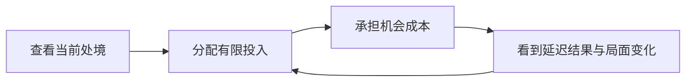

# Lead Product Analyst 独立分析：加入实际游玩反馈后的修正

2026-10-26。独立提案，未确认、未实现，不替换当前 MVP。依据为用户自述、现有方案与原站公开说明；不代表广泛玩家研究。

## 修正结论

**最新澄清是“仿佛存在人生最优解”。优先验证经营选择能否容纳不同追求，而不只区分不同局面。** 这提示目标单一或明显优解的感受，尚不能断言原作真有数学上的全局最优策略。此前短叙事优先的推荐继续后置。

“经营感”是用户对体验的描述，还不能直接等同于“用户想做深度经营游戏”。推荐先验证一个很小的经营循环，而非立即加入多套数值和系统。

## 新证据与边界

| 用户提供的信息 | 证据性质 | 当前能说明什么 |
| --- | --- | --- |
| 玩到了经营感；多局后“仿佛存在人生最优解” | 实际游玩的直接自述 | 优先检查玩法是否暗示统一价值目标或明显优解；不是已经证明存在占优策略 |
| 丰富的 sharing 模板让他印象深刻 | 信息/视觉印象 | 模板选择可能有价值，不能推定已经选择、导出或发布过 |
| 同时有多少人在玩、他们的进度很有趣 | 信息印象 | 共同在场与比较可能吸引人，不能推定它已改善游玩或重开 |

用户还特别说明后两者来自看到的信息。当前不把“印象深刻”升级为已验证的使用价值。Sharing 仍按先前决定后置。

“并行人生”还需区分真实在线玩家、模拟同伴和历史人生；尚未核实用户具体指哪一种。原站首页的并行呈现可作机制参考，但不能因此认定其全部都是实时玩家进度。[官方首页](https://1in8b.life/en/)

## 为什么两次固定分支仍然别扭

它证明了前一选项能解锁后一选项，却删掉了经营所需的资源分配、机会成本和局面判断。玩家主要辨认路线，没有反复权衡如何经营当前处境。

最新反馈已把问题收敛到“人生像有标准答案”，不再重复笼统追问。固定的学习→资格→岗位路线，容易强化一种默认成功方向；仅增加事件或文案不能保证改变这种感受。

需要区分：人生追求可以主观、多目标且会变化；给定追求和局面，可以存在合理的局部更优策略；同一条件下，某选项在所有相关后果上不差、至少一项更好，才涉及选项支配。局部优势不等于全人生的统一最优，原作是否存在后者尚待核实。

加随机仍可能保留期望收益最优策略，隐藏结果只是让答案更难看见。可用“当期安稳、探索成长、自主时间”等两三种追求检查设计，不强制玩家开局选价值标签；偏好也可在行动中表达和改变。

## 重新比较产品方向

| 方向 | 当前证据与建议 |
| --- | --- |
| 轻经营为主体 | 最接近实际游玩反馈；优先检验同样行动在不同局面下是否产生不同取舍 |
| 人生叙事为主体 | 可让结果更有记忆，但尚无用户讲述具体故事的证据；暂作表现层，不主导范围 |
| 观察并行人生为主体 | 信息印象较强，可能形成陪伴或比较；先做独立概念验证，不直接建设实时多人系统 |

三者可以长期结合，但不应同时成为首轮必须完成的产品。

## 最小实验：同组选项，不同处境

先验证一段青年期经营，而非承诺完整一生。维持日常并培养技能只是一种实验情境，不是全体玩家统一的人生目标。先用资金与时间约束呈现取舍，后果在后续回合兑现，不增加更多数值条。

纸面例子：A 去外地参加高回报项目，得到新经验和收入，但占用大部分自主时间；B 留在常规工作，收入增长较慢，却保留熟悉安排和可支配时间。两者没有统一排名，结局并列写获得与放弃，不加权成总分。此例只用于验证，不把迁居或家庭系统拉进 MVP。

初次实验固定外部变化，便于判断选择为何改变；无需先加随机事件池、国家模型、年度计算或复杂职业市场。完成一轮后换一个处境，再观察是否想调整投入。

**有效差异来自玩家因局面主动取舍，而非系统锁掉一个按钮。** 暂时不能负担的方案可以存在，但“选项被禁用”不能独自证明有经营深度。也不要求玩家一定换选项：个人偏好可以稳定，关键是他能理解代价，而非始终认定某按钮全面占优。

最小验证：把同组选项放入两种局面，请玩家说明此刻在意什么，再观察选择与理由。检验是否能基于不同追求或承诺作出合理取舍，以及后果是否改变下一轮安排；不要求人人换选项，也不把所有选项做成一样好。

## 共同在场与模板为何值得保留研究

共同在场可能让单人体验像一个仍在运转的世界；他人进度也可能提供时间坐标或比较对象。这是价值假设。可另做标注为演示数据的面板，观察用户会否主动回看、查看他人或因此继续；如果只贡献氛围，轻量展示可能已足够。不能伪造真实在线人数。

模板选择可能提供表达自主权：同一段人生，可以由用户决定怎样呈现和留存。需后续观察实际挑选、切换、保存的行为，才能判断它是好看的素材库还是常用能力。暂不据此提前加入发布、社区或大量模板。

## 仍需澄清与扩展基础

后续若需核实，只追问一个具体的“像标准答案”的选择及其反馈，检查真实机会成本是否缺失。共同在场、模板价值和面向哪些玩家仍待验证，不因这次澄清直接扩张范围。

现在保存当时处境、可用行动、实际投入、后果与来源事件，足以支持调试、结果回顾及未来分享。随机内容启用后保存抽样结果；没有并行跨年活动时不提前建通用队列。原有特殊事件记录能力保留，但本轮先证明为什么会产生不同经营经历。
