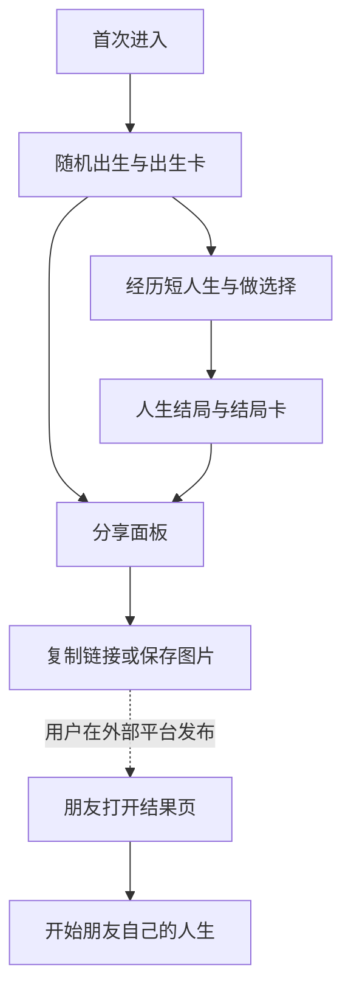

# MVP 草案：随机人生的分享实验

状态：提案，未实现。更新于 2026-10-26。

## 1. 本次 MVP 要回答什么

目标是验证：**随机人生能否产生表达意愿，以及结果分享能否带来新玩家开局。**

交付一段可以完整经历的短人生，并把出生结果、结局结果和朋友回流连接起来。长期耐玩性、全世界覆盖和商业化留到后续。

| 假设 | 观察方法 | 什么结果会让我们调整方向 |
| --- | --- | --- |
| H1：出生结果本身就有表达价值 | 出生卡曝光后，是否打开面板、复制、保存；访谈为什么愿意或不愿意分享 | 用户看不出差异、没有可表达的点，或分享操作持续无人使用 |
| H2：经历一生能增加结局的表达价值 | 保留完成率，分别观察出生卡和结局卡的曝光与分享操作，并访谈同一批完成者 | 玩家难以坚持到结局，或结局只是重复出生信息，无法讲出经历 |
| H3：看到朋友结果会引发自己的开局 | 带分享标记的结果页访问 → 点击开始 → 成功出生 | 访客能看懂朋友结果，却不愿开始自己的体验 |

第一轮用于定性排错与发现动机，暂不设没有依据的行业转化率目标。可以先邀请 5–10 位测试者；少量样本只提供方向，不能用于证明传播规律。

## 2. 提议的首版范围

| 模块 | 首版交付 | 完成边界 |
| --- | --- | --- |
| 入口 | 一句玩法说明和一个开始按钮 | 无需注册，可在手机操作 |
| 出生 | 5 个国家、性别、家庭条件、出生卡 | 结果差异可理解，统计与虚构背景分开标注 |
| 人生 | 约 30 条事件模板、少量选择、3–5 分钟完整一生 | 出生到结局可跑通，年龄和人物状态无明显矛盾 |
| 状态 | 健康、教育/能力、经济、关系等少量必要状态 | 只保留会影响事件或结局的字段，不为了面板凑数 |
| 存档 | 当前人生和最近少量人生的本地记录 | 刷新可继续，存档损坏时有可理解的恢复方式 |
| 结局 | 简短人生摘要、关键事件、结局卡、再来一局 | 摘要能说明这一生发生了什么 |
| 分享 | 两种卡片、复制文案和链接、图片保存 | 结果可在另一浏览器查看，分享路径见下节 |
| 结果落地页 | 朋友的结果与“开始我的人生” | 不因访问他人结果覆盖自己的存档 |
| 观察 | 卡片曝光、分享操作、结果页访问、新开局 | 出生/结局、来源与分母能区分 |

首批国家尚未确定，以核心数据能追溯且差异足以支撑实验为选择依据；不直接继承二创数据作为已核验事实。

暂缓：站内故事墙、追思馆、公开评论与点赞、账号、跨设备存档、支付、视频纪念品、多语言、历史/未来世界、复杂投资、族谱、完整四人平行人生。

## 3. 用户流程与分享边界

以下是本项目的提案流程，不表示已实现或原站的内部架构。

分享的对象是**结果快照**。MVP 不要求朋友逐年重播完全相同的一生，也不把随机种子当作公开访问凭据。

内部保留随机种子、规则版本与事件记录，用于调试和复现。完整重播是后续功能；手动选择不能仅靠随机种子还原。

本地研究原型可用体积受限的结果链接验证跨浏览器查看；公开实验版需解决稳定结果地址、社媒预览图和版本兼容。具体采用链接编码、服务端快照或静态生成，在实现前做一个小验证后决定。

## 4. 数据与事件如何控制工作量

首批只整理与出生和核心体验相关的少量字段。每个字段至少记录：

| 字段 | 需要记录 |
| --- | --- |
| 指标名称与定义 | 它代表什么，是否与页面文案一致 |
| 数值与单位 | 原始值、展示值、单位换算 |
| 年份与来源 | 观测年份、数据版本、可访问出处 |
| 处理方式 | 归一化、估算、缺失值处理 |
| 核验状态 | 已核验 / 待核验 / 模型假设 |

出生抽样的概率只在纳入的 5 个国家内归一化，页面应明确这是样本范围；不能显示成全球出生概率。

平均寿命不能直接当作死亡年龄分布。若首版采用简化寿命或事件规则，应标成模型假设。扩展到按年龄与性别的死亡风险，需要另行取得并验证生命表。

事件由规则与模板驱动。AI 可以辅助开发与起草，但首版不依赖每年实时调用模型；先把触发条件、状态变化、互斥条件和文案做成可检查的内容。

## 5. 统计约定

建议的最小事件：

| 事件 | 用途 |
| --- | --- |
| `life_started` | 成功生成一段人生，区别于仅点击开始 |
| `birth_card_viewed` / `ending_card_viewed` | 两类分享操作各自的曝光分母 |
| `share_panel_opened` | 分享入口被使用 |
| `share_action` | 记录复制成功、图片保存等可观测操作；附卡片类型与动作 |
| `life_completed` | 计算开局到结局的完成率 |
| `shared_result_viewed` | 带标记结果页的访问 |
| `referred_life_started` | 从结果页进入并成功生成自己的人生 |

无法读取外部平台的发送结果时，不设置“分享成功数”。分享按钮点击只代表意图，保存图片也不能证明图片已经发布。

出生卡与结局卡的用户群和曝光机会不同；不能直接比较原始点击数后得出哪一种更有效。预览爬虫、自己打开的链接和重复刷新也需要与真实访客区分。

基础统计只收集验证这些路径所需的事件与匿名标记；自由填写的人生感想和私人信息不进入统计。

## 6. 两个验收阶段

### 研究原型

- 能从出生完整走到结局，选择确实改变状态或后续路径。
- 同一规则版本下，内部记录能帮助复现与定位异常。
- 不出现明显年龄、人物存亡或家庭状态矛盾。
- 两种卡片可生成，长姓名和中文排版可读。
- 结果链接在另一浏览器可打开，且不会覆盖本地正在进行的人生。
- 测试者能用自己的话说明出生条件和这一生的关键经历。

### 公开实验版

- 验证目标手机浏览器上的保存、复制、外部打开和返回流程。
- 结果地址稳定，社媒预览可读取，错误链接有回退页面。
- 能分别计算卡片曝光、分享操作、结果页访问与回流开局。
- 用有效访客检查统计链路，排除爬虫与明显重复访问。
- 数据核验状态和模型假设可从界面找到。

## 7. 工作量初估

假设：一名熟悉前端的人配合 AI，每人日约 6 小时有效投入。各档为累计总量，包含相应拆解、实现和验证，不应相加。

| 阶段 | 估计 |
| --- | --- |
| 产品拆解与范围确认 | 1–3 人日 |
| 可玩研究原型 | 4–7 人日 |
| 可公开测试的实验版 | 12–20 人日 |

公开实验版的新增工作主要是内容与数据检查、真实分享落地、移动端兼容、统计与异常处理。真实传播的观察期另计，开发完成不意味着已有足够流量样本。

## 8. 下一轮讨论的三个决定

1. **研究重点：** 先比较出生与结局的分享动机，还是先验证朋友结果能否带来新开局？建议以前者为主，后者保留最小可观测路径。
2. **体验长度：** 是否接受首版 3–5 分钟的一生？建议先采用，降低测试者看不到结局的概率。
3. **交付阶段：** 第一轮停在可玩研究原型，还是直接做公开实验版？建议先验收原型，再决定继续投入。

这些建议尚未视为用户确认的最终产品决定。
