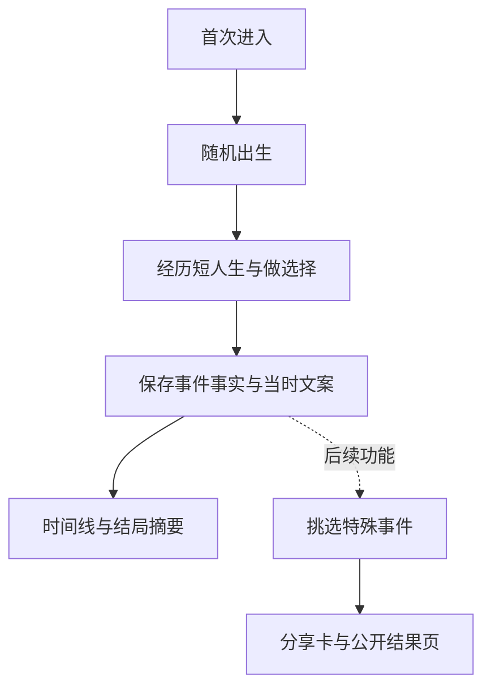

# MVP 草案：完整人生与事件记录

状态：提案，未实现。更新于 2026-10-26。

已确认的方向调整：sharing 作为后续补充 feature。首版先完成人生体验，并为特殊事件保留可持久读取的记录。其余具体范围和技术字段仍是提案。

## 1. 本次 MVP 要回答什么

目标是验证：**出生条件和玩家选择能否形成自洽、有记忆点的人生，以及这些经历能否被完整保留。**

交付一段可以完整经历的短人生，配有人生时间线与结局摘要。分享、长期耐玩性、全世界覆盖和商业化留到后续。

| 假设 | 观察方法 | 什么结果会让我们调整方向 |
| --- | --- | --- |
| H1：不同出生条件会形成可感知的体验差异 | 测试者比较几段人生，说明有哪些机会、限制与经历不同 | 差异只停留在国家名字或初始数值，后续故事基本相同 |
| H2：选择能影响后续人生 | 观察选择后的状态、事件与结局，并访谈玩家是否理解影响 | 选项只改变一行文案，玩家无法感知后续结果 |
| H3：短人生中有能被记住的特殊事件 | 结局后请测试者回忆经历，再与事件记录核对 | 事件重复、互相矛盾，或只能回忆最终数值 |

第一轮用于定性排错与发现记忆点。可以先邀请 5–10 位测试者；少量样本只提供方向，不用于证明普遍的产品或传播规律。

## 2. 提议的首版范围

| 模块 | 首版交付 | 完成边界 |
| --- | --- | --- |
| 入口 | 一句玩法说明和一个开始按钮 | 无需注册，可在手机操作 |
| 出生 | 5 个国家、性别、家庭条件、出生信息页 | 结果差异可理解，统计与虚构背景分开标注 |
| 人生 | 约 30 条事件模板、少量选择、3–5 分钟完整一生 | 出生到结局可跑通，年龄和人物状态无明显矛盾 |
| 状态 | 健康、教育/能力、经济、关系等少量必要状态 | 只保留会影响事件或结局的字段，不为了面板凑数 |
| 事件记录 | 已发生事件、玩家选择、结果、年龄与顺序 | 事实与文案分别保存，刷新后仍可定位到同一事件 |
| 存档 | 当前人生和最近少量人生的状态与事件 | 刷新可继续；存档带结构版本，关键记录与状态一起保存 |
| 结局 | 简短人生摘要、关键事件、再来一局 | 摘要由已发生的记录组成，能说明这一生发生了什么 |
| 观察 | 开局、完成、异常与测试者反馈 | 先验证体验，首版不以分享转化作为验收 |

首批国家尚未确定，以核心数据能追溯且差异足以支撑实验为选择依据；不直接继承二创数据作为已核验事实。

暂缓：分享面板、卡片图片导出、公开结果链接、分享归因统计、站内故事墙、追思馆、公开评论与点赞、账号、跨设备存档、支付、视频纪念品、多语言、历史/未来世界、复杂投资、族谱、完整四人平行人生。

## 3. 用户流程与后续扩展

以下是本项目的提案流程，不表示已实现或原站的内部架构。

首版采用**当前状态 + 已发生事件记录**。不需要为了未来分享建设完整的事件溯源系统，也不要求仅靠事件重建整个游戏状态。

记录覆盖玩家实际看到的事件和已结算的选择；无事发生的年份和动画帧不必逐条存储。特殊事件用类型和标签识别，重要性排序、用户收藏和分享挑选可以后补。

随机种子与规则版本辅助调试，但不能替代对手动选择及实际结果的记录。后续分享默认读取已发生的结果快照，完整重播另行设计。字段、写入时机和旧存档兼容见 [事件记录设计](event-records.md)。

## 4. 数据与事件如何控制工作量

首批只整理与出生和核心体验相关的少量字段。每个字段至少记录：

| 字段 | 需要记录 |
| --- | --- |
| 指标名称与定义 | 它代表什么，是否与页面文案一致 |
| 数值与单位 | 原始值、展示值、单位换算 |
| 年份与来源 | 观测年份、数据版本、可访问出处 |
| 处理方式 | 归一化、估算、缺失值处理 |
| 核验状态 | 已核验 / 待核验 / 模型假设 |

出生抽样的概率只在纳入的 5 个国家内归一化，页面应明确这是样本范围；不能显示成全球出生概率。

平均寿命不能直接当作死亡年龄分布。若首版采用简化寿命或事件规则，应标成模型假设。扩展到按年龄与性别的死亡风险，需要另行取得并验证生命表。

事件由规则与模板驱动。AI 可以辅助开发与起草，但首版不依赖每年实时调用模型；先把触发条件、状态变化、互斥条件和文案做成可检查的内容。

## 5. 观察与后续分享实验

首版先观察体验是否成立；游戏内部的人生事件记录与产品使用统计分开保存。

| 事件 | 用途 |
| --- | --- |
| `life_started` | 成功生成一段人生，区别于仅点击开始 |
| `life_completed` | 计算开局到结局的完成率 |
| 异常记录 | 检查事件冲突、重复结算、存档失败等问题 |

测试阶段可先在本地查看统计与反馈；公开收集产品事件时再明确接收端与最小字段，不把整个人生记录自动上传。

后续 sharing 可验证：出生或特殊事件是否引发表达意愿、结局是否增加分享价值、朋友结果是否带来新开局。这些不属于首版完成标准。

届时区分卡片曝光、打开面板、复制/保存、有效结果页访问和回流开局。点击不等于发送成功；不同分享对象的曝光机会与访客群也不能直接混比。

## 6. 验收阶段

### 研究原型

- 能从出生完整走到结局，选择确实改变状态或后续路径。
- 同一规则版本下，内部记录能帮助复现与定位异常。
- 不出现明显年龄、人物存亡或家庭状态矛盾。
- 同一年多件事有稳定顺序，每次事件有独立标识。
- 刷新后关键事件与选择仍存在，待选择事件不会重复结算。
- 事件事实和当时文案可分别读取，修改模板不改变旧人生的既有叙述。
- 特殊事件可按类型或标签筛出，结局摘要不编造未发生的经历。
- 测试者能用自己的话说明出生条件和这一生的关键经历。

### 可公开测试的游戏 MVP

- 验证目标手机浏览器上的完整人生、暂停、刷新恢复和历史记录。
- 能处理存档版本差异、损坏或写入失败，不静默丢弃既有人生。
- 用测试人生检查触发条件、选择结果与人物关系的一致性。
- 数据核验状态和模型假设可从界面找到。

未来增加分享时，另行验收图片导出、跨设备结果页、社媒预览、发布内容选择和回流统计。

## 7. 工作量初估

假设：一名熟悉前端的人配合 AI，每人日约 6 小时有效投入。各档为累计总量，包含相应拆解、实现和验证，不应相加。

| 阶段 | 估计 |
| --- | --- |
| 产品拆解与范围确认 | 1–3 人日 |
| 可玩研究原型 | 4–7 人日 |
| 可公开测试的游戏 MVP，暂不含 sharing | 8–12 人日 |

事件结构、持久化与恢复验证计入首版估算。公开游戏 MVP 的新增工作主要是内容与数据检查、移动端兼容和异常处理。Sharing 后续按选定的输出形式另估，不沿用之前含分享链路的 12–20 人日范围。

## 8. 下一轮讨论的三个决定

1. **特殊事件的范围：** 先列出希望被记住的经历，如升学、迁居、职业转折、关系变化与意外收获；首版优先打磨其中几类。
2. **体验长度：** 是否接受首版 3–5 分钟的一生？建议先采用，便于完整测试与比较几段人生。
3. **结局摘要：** 先采用固定规则挑出几件关键事件，还是让玩家自己标记？建议先做规则摘要，收藏和主动挑选后补。

这些建议尚未视为用户确认的最终产品决定。
