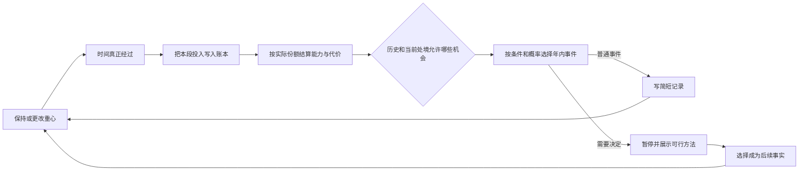

# 1in8b 核心循环：投入、状态与后续机会

2026-10-29。此次目标是独立复现“持续日常投入会改变后来可能发生的事和处理办法”，而非继续只做相似界面。本页区分原作证据、我们采用的设计，以及尚未核实的部分。

## 原作已观察到什么

| 机制 | 可支持的结论 | 证据与边界 |
| --- | --- | --- |
| 持续重心 | 重心可以在年内更改；点选本身不立即增加年龄、状态或记录 | [2026-10-28走查记录](../../artifacts/1in8b-recheck/observations.json)：42岁从工作切到家人朋友，三者立即均未变。该文件是本次任务工作区保留的运行观察，不属于Git仓库发布内容 |
| 年内投入 | 历史发布脚本的 `tick()` 累计各重心的实际使用时长，`endYear()` 按比例作用；年末才增加年龄、规划下一年 | [历史源码复核](one8b-time-rhythm.md#静态实现与实际观察)，对应 v0.8.47 精确发布文件，`tick()` L1701、`endYear()` L1711–1717、`focusOptions()` L1579、切换处理器L4482。不能据此保证现版公式完全相同 |
| 普通生活与决定分流 | 年内有普通记录候选；普通记录可以自动发生，只有需要回答的决定进入暂停弹窗 | 历史脚本 `planYear()` L1699–1700、`fire()` L1701–1702、`openDecision()` L1978–1980。候选会被条件过滤，不能断言每年必有固定条数或固定次数 |
| 状态改变可能性 | 当前官方说明把状态与不同机会关联，并明确高状态只提高可能性，不保证结果 | [当前简体页面](https://1in8b.life/zh-hans/)“这些状态代表什么”与[官方FAQ](https://1in8b.life/en/about/)“How does a life go?”。它们没有公开完整概率公式 |
| 历史与处境改变处理办法 | 可选工作不只是一个统一职业按钮：会引用既有学历、工作经历、居住地，也可能有朋友介绍的具体机会 | 2026-10-28走查中，生意结束后43岁出现新工作抉择，某岗位注明朋友Santiago介绍，另有按既往27年工作经历计薪的选项 |
| 选择后回到生活 | 作答关闭弹窗并写回状态，不普遍要求领取成果后再点继续 | 历史脚本 `pickChoice()` L4281；2026-10-29浏览器也观察到拒绝吸烟后返回生活，暂停按钮显示可暂停的运行状态 |

官方页面将健康关联生存与工作能力、知识关联升学和工作机会、关系关联家庭与晚年经历；这些是当前官方的机制说明，不是本项目已核验的现实统计。我们不把一次生意倒闭、一次年度状态变动当成某个重心必然导致的结果：42→43岁期间还发生了多件事，无法隔离单一因果。

## 历史源码的可复用程度

[历史复核](one8b-time-rhythm.md)记录的公开脚本为 `https://1in8b.life/a/zh-hans.b1f61febf5.js`，SHA256 `b1f61febf5274d139e17b87ec97e8a4ab2e826739c04e1de405c6f23b74a88cd`。旧 REA parent Evidence 为 `ev_af98258d643ed3884ade5531ea7aaa1e8bd7d9a5cc7ea9763be7696a694a3567`，其图覆盖为partial，不能当成完整调用图证明。

本次在允许的项目artifacts中未找到该JS副本；按精确旧Evidence ID查询当前 REA 会话返回0条保留记录，不能重新钻取旧图。此前当前版本 v0.8.73 主脚本直下返回403，本次不重试或绕过限制。因此这里复用的是有版本与行号边界的历史记录，新增确认来自当前官方说明及已保留运行观察，不声称已取得现版完整源码。

## 我们采用的独立实现原则

下面是本项目的设计选择，不是宣称原作使用同一数据结构、步长或数值。

1. **真实的投入账本。** 时间与点击次数分开。切换重心仅修改今后的安排，不能把已经度过的部分重新算给新重心。暂停、待答、隐藏页面都不累计投入；倍速只影响现实等待时间，不放大同一段虚拟时间的收益。
2. **持续累计与当期代价同时存在。** 能力、真实合作经历可跨年保存；精力、备用金、近期联系是当下处境，不能用永久熟练度自动替代。重复投入不应把所有状态同时推高。
3. **事件资格与抽取分开。** 年龄是适用窗口之一，事件还可要求实际投入、能力、先前参加过的事、人物关系或现实时间条件。达到资格不意味着每年必定发生同一个事件。
4. **事件发生与方法可用性分开。** 同一问题可能人人都会遇到，但准备充分、积累合作或保留资源的人有不同处理办法；普通数值不能替代“曾真实一起做过某件事”的事实。
5. **作答会改变后续机会。** 例如一次技能机会可以选择独立完成或接受合作；两者应改变今后的经历条件，而不是只写不同一句结果。拒绝机会也要保留为明确历史，避免之后假装参加过。
6. **可验证的随机性。** 若使用概率，应采用可重放种子与持久结果。刷新、切倍速、拆成不同大小的时间推进，不应重新掷同一件事或篡改过去的结果。
7. **展示可追溯原因。** 玩家应能看到本年真实投入的分配、当前能力与不可行原因，识别“为何遇到这件事/为何能这么处理”。不把未来每件事写成等天数解锁的任务清单。

### 中国样本的三条设计验收路线

以下是本项目的独立设计与验收条件，不是原作数值或已经发生的玩家数据。机会在适用阶段内按真实状态与种子抽取，不保证每个年龄都一定出现；比较时应固定同一种子并保留实际抽取结果。

| 路线 | 真正投入与早先决定 | 之后同样继续投入时应有什么不同 |
| --- | --- | --- |
| 先把故事剪明白 | 先给作品留出一段真实时间；遇到素材互看时选择练结构，然后继续投入，实际完成一段结构练习 | 后续可能收到结构方向的试剪互看机会，能用已做过的结构经验处理问题；单有相同一般熟练度、但没有完成过该方向的人不能替代这段经历 |
| 先把声音听顺 | 与上一条使用相同的早期投入，在互看时改选声音；之后投入同样长的作品时间，真实完成声音练习 | 之后的机会改为声音方向，人物会引用已经共同看过或处理过的素材；不能把两种方向仅写成同一个事件的两句皮肤文案 |
| 和周舟真正一起做 | 先把实际时间留给来往；收到采录请求后，可以只帮约采访，也可以答应共同处理一段。答应不等于已经合作，要再花真实时间做完 | 只帮联系与真实共同完成形成不同历史。29岁时，一般来往程度不能替代共同剪过一段；联名处理还要看当下精力、票钱和近期联系，并承担之后的履约时间 |

另设一个不依赖机会运气的账本检验：先给作品留45天，再安顿生活30天，界面必须显示作品1.5个月、安顿1.0个月；最后切回作品，不能重写前面的30天。暂停与待答期间也不能暗中多出投入。

三条路线均保留原29岁冲突里的具体代价：个人完整版保留独立署名但错过关门，精简版舍去夜班段落，联名版共同署名并有后续承诺，回乡路线陪伴家人但不参加本届征集。不能把某一条做成所有内容与关系均可无代价拿满的统一答案。

## 验证应该对比什么

- 同种子、相同虚拟总时长，早先投入不同，后来事件或可选方法应出现可解释差异。
- 年末前切重心，不能覆盖之前大部分时间的投入。
- 相同累计时长被切成不同推进段，结算应一致；暂停和待答不应偷走时间。
- 同等一般熟练度，具有真实合作历史的人与从未合作的人，能做的事应不同。
- 同一重心持续使用，应产生普通生活与少数机会，不是每次点击都有成果，也不是每年固定解锁一个任务。
- 事件一经发生与选择，就保持为本局事实；恢复存档不能重复结算或重新抽结果。

## 已实现与验收

当前 `/replica/` 已接入独立v3引擎，实际模拟日、累计投入、月度条件机会、后续项目完成和旧存档迁移均已实现。原 `/` 与 `/life/` 继续进入同一页面，旧版仍在 `/life/previous.html`。

默认153项检查通过，其中18项直接检查这次核心引擎。检查包括分段推进等价、最后一刻切换不回溯、相同投入因结构／声音选择产生不同后续、真实合作与普通来往分开、待答不推进和刷新不重抽。有限种子走查验证了完整人生接续与严格重放；数量不代表内容篇数或趣味已经成立。

浏览器实际走查中，4.1个月作品投入之后改去安顿，先前投入保留，声音练习也停在4/60天；恢复作品时间后才完成声音经验，后来遇到引用该经验的录音整理机会。窄屏345px下账本与抉择可操作、没有横向溢出。另修复了连续数值产生的小数票款边界：250元现金支付后，750元待补会真实保留，只在后续确有备用钱时偿还。

## 尚未核实与没有声称复刻的部分

原作现版各重心的精确增减公式、概率曲线、饱和与衰减函数、事件权重、随机数源、冷却、全部资格条件、全部历史组合和各国参数均未独立还原。原作的真实人口、寿命、疾病、宏观经济与完整事件库也不由本次资料证明。本项目的中国虚构样本可以采用同类核心循环，但应把自行设定的参数写成游戏设计，而非标注为原作数值或中国真实统计。
