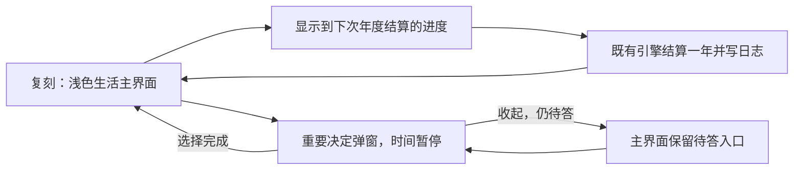

# 1in8b 界面与操作流程复刻

2026-10-29。用户在上一轮 UX 调整后仍觉得体验不好，要求先复刻原作。本轮改为按原站实际页面制作可对照的界面与操作流程，不继续叠加独立的管理界面。

## 观察与证据

本轮原站走查显示 v0.8.73，主界面为浅色三栏；普通生活以简短日志进入时间线，重要决定使用弹窗。决定可以收起，但收起后仍为待答状态，时间继续暂停。这里记录的是本次页面观察，不表示已取得官方源码或核验全部事件。

来源：[原站简体中文页面](https://1in8b.life/zh-hans/)。主流程的历史静态证据见 [2026-10-26 时间与事件节奏复核](one8b-time-rhythm.md)：当时 v0.8.47 的公开发布脚本中，`tick()` 推进年内进度，`openDecision()` 暂停等待回答，`pickChoice()` 关闭决定并回到生活；普通记录与待答事件走不同处理路径，日志可主动加星。旧脚本的哈希、行号与 REA partial 覆盖限制保留在原记录，不把它们当成 v0.8.73 的完整源码结论。

本次浏览器观察到主脚本地址 `https://1in8b.life/a/zh-hans.4360d1a198.js`，直接下载返回403，未取得该版本完整脚本，也未绕过限制。本次新增结论来自浏览器可见页面与实际操作，没有新增 REA 源码证据。原站存档从14岁继续，快进触发一处决定，验证弹层与收起入口；没有遍历整个人生或核验事件概率。

## 上一版偏离在哪里

上一版把普通故事和关键决定一起放进长篇阅读流，再加入固定底部操作区、安排／近况／记录共用查看层、预约收据和推进反馈。它解决了一些按钮和阅读位置问题，但属于我们自己的 UX 设计。它没有复现原作中“平常看生活流动，重要事情才展开决定”的界面层级。

现有游戏也不同于原作模拟：它是固定中国人物与有限故事，主要可安排阶段为23—30岁。过去每年结算一次，使用结算时选中的重心，不累计年内各种重心各用了多久。

## 本轮复刻范围

本轮先复刻主界面布局、短日志的呈现层级、时间控制、持续重心入口、重要决定弹窗及收起后重新打开的流程。中国人物和既有故事作为可玩的内容样本，不将其包装成原站的事件池。

年内画面进度只表示距离下一次现有年度结算的进度。它由独立的纯显示函数推进，暂停、隐藏页面、其他弹窗、待答决定及尚未选择初始重心都会阻止推进；收起决定不取消待答限制。到达终点后由页面调用既有引擎结算一年，再重置显示进度。快进也逐年结算，不能跳过待答决定。

这不是按时长分摊投入的实现。现有引擎仍以结算时的重心处理整年；画面流逝期间改变重心，不声称此前时段已按旧重心结算。原作按年内实际使用时间累计、年末按比例作用的投入账本未在本轮复刻。

## 明确没有复刻的部分

- 全球随机出生、国别制度和完整人口概率模型。
- 原作统计资料的可信性、数据核验及真实寿命模型。
- 原作完整事件池、跨阶段的模拟与全部数值平衡。
- 年内各重心的实际投入账本和按比例年度结算。
- 真实在线玩家、并行人生和其他人的实时进度。
- 多套分享模板、公开结果页、社区传播与分享后端。

本轮的验收是与原站逐步对照界面和操作路径，确认用户能够找到当前时间、生活重心与眼前决定，决定收起／展开／作答的行为一致。能运行、检查通过与界面接近，不等于已经证明本项目的内容和模拟同样好玩。

## 试玩与实现

[打开对照复刻](https://three-weekends-yuki.yuki-uix.chatgpt.site/replica/)；[上一版](https://three-weekends-yuki.yuki-uix.chatgpt.site/life/previous.html)保留。首页及 `/life/` 统一跳转到 `/replica/`，避免收藏旧入口时仍看到旧界面。

新页面使用独立的 `china-life.replica.save.v2` 与 `china-life.replica.ui.v1`，不覆盖上一版进度。故事继续通过原引擎生成；收藏来自本局实际日志，结尾可以把普通收藏或原有记忆放进同一张本地卡片。新增5项只读适配器检查与7项显示时钟检查，默认测试总数138项。
