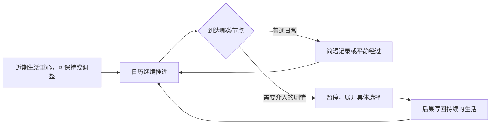

# 1in8b 时间推进与事件节奏复核

> 历史研究：本页保留2026-10-26的原站观察及当时原型状态。现行范围见 [中国完整一生 MVP](china-life-mvp.md)；证据边界与旧脚本结论不因规划更新而改变。

2026-10-26。研究原站 [简体中文版](https://1in8b.life/zh-hans/) 的公开发布页面、前端主脚本与一段短程运行表现；不代表获得作者私有源码，也不核验国家统计或所有事件分布。当前试玩仍为 v0.3，本轮未改线上代码。

## 用户指出的偏差

「每一个选择都有一个成果，有点太刻意」「日常是大部分，但有些特殊节点可能触发特殊剧情」「现在没有时间线的感觉」。这已经明确了期望，不应继续把每次日常都包装成值得收藏的小故事。

## 证据边界

- 原站页面本次显示 v0.8.47；[官方说明](https://1in8b.life/en/about/)描述按年推进、可更改重心、遇到抉择再决定，以及暂停/加速控制。
- 公开主脚本：[zh-hans.b1f61febf5.js](https://1in8b.life/a/zh-hans.b1f61febf5.js)，4,282,816 字节，SHA256 `b1f61febf5274d139e17b87ec97e8a4ab2e826739c04e1de405c6f23b74a88cd`。以下行号对应这份精确发布文件，不是格式化后的代码。
- REA parent Evidence：`ev_af98258d643ed3884ade5531ea7aaa1e8bd7d9a5cc7ea9763be7696a694a3567`；summary：`ev_fd9c5773bc7ebecf7d6020eaa3c01787dcd5fb85c80691a86463fc9d2b7124cc`。一个 JS 成功解析，访问 872,679 个 AST 节点；语义图触及 100,000 节点限制，为 **partial**，不能宣称完整调用图已证明所有运行行为。下表由针对性直接阅读补足。
- 运行中还观察到另一份同源 keepx 脚本与 Cloudflare 统计脚本，此次没有分析。没有调用源站私有接口、读取其他人的浏览器数据或把原站代码复制进本仓库。
- 初次 REA 调用发生在脚本下载完成前，只含 HTML，parsed JS 为 0；其 parent `ev_59b1eae8b7ae7beb48ea64721593fc4c71f165a321dd5a90eef408ed937aada3` 不用于下面的 JS 结论。下载完成后输入发生变化，另行分析了完整主脚本。

## 静态实现与实际观察

| 问题 | 公开脚本能证明的实现 | 运行观察与边界 |
| --- | --- | --- |
| 时间怎样前进 | `tick()` L1701 依帧间隔、速度与每年时长推进年内进度；暂停或等待回答时停止。`endYear()` L1711–1717 结算并增加年龄、规划下一年 | 页面有年龄、年份、年内进度条和倍速。短程观察中，未逐年点击也从幼年走到 14 岁；重新打开仍能继续保存的年龄 |
| 日常投入是什么 | `focusOptions()` L1579 返回阶段适用重心；点击处理器 L4482 修改持续重心。tick 累计各重心实际使用时间，endYear 按比例作用于状态 | 在正常可见的重心菜单中，将「朋友·玩耍」改为「兴趣」，仍停留在同一生活页面，没有统一成果页 |
| 普通记录怎样出现 | `planYear()` L1699–1700 先计划 2–3 个普通 feed 候选，再另排初始抉择。`fire()` L1701–1702 的普通事件分支执行并写日志，没有一律设置待答 | 时间线按年龄记录成长、家庭与普通日常；不要求玩家为每条记录先完成一次动作 |
| 什么事情会暂停 | `fire()` 的 decision 分支进入 `openDecision()` L1978–1980，待答时 tick 停止 | 可访问树观察到幼年气质、兴趣与升学等抉择；5 岁的反思问题另有暂停。只覆盖一段短程，不推断所有人生的密度 |
| 选择后是否领奖 | `pickChoice()` L4281 关闭弹窗、执行决定、刷新和保存。中央路径没有统一的「领取成果，再点继续」步骤 | 抉择处理后可回到生活页面与继续的年龄变化。个别事件可能接续额外抉择或展示，未逐项审计 |
| 哪些东西值得珍藏 | 普通日志和待答事件为不同处理路径；页面允许给日志加星 | 「精选」可以来自对既有记录的主动标记，而不是每次日常必定发放一个物件 |

注意：每年计划的普通候选可能被条件过滤；初始抉择虽取前两项，运行中还可追加抉择，**不能说全年绝对最多两次**。原作也不是「平常年份完全没有记录」：例如安静的早晨、雨天下午等普通暖记录，可以自动进入时间线并轻微影响状态。应区分普通记录、需要介入的剧情和精选记忆。

不要把 survival 的 `MILESTONE_AGES` 日志节点，与 5/15/30/50/70 岁的反思暂停直接当成同一个系统。此处未调查具体事件的概率平衡、真实统计适配或全部后续支线。

## 与当前 v0.3 的结构差异

当前代码的实际问题，不只在成果卡的字样：

1. [engine.js](../web/dist/engine.js) 结算要求 choice 的 memoryId 存在，并无条件追加一份 memories；普通选择不能没有纪念物。
2. [app.js](../web/dist/app.js) 每次选择后都设 feedback，下一选择受阻，必须看完统一结果再点继续。
3. 状态里的 semester/slot/turn 是操作计数；没有与选择次数分开的周、月及流逝时间。
4. 每学期两次活动后必进一个剧情节点，特殊剧情相当于固定第三步。
5. 同一活动同学期不能重复，玩家无法把某件事作为普通习惯延续。

因此现在像六段连续精选的小故事，而不是一段通常平淡、偶尔值得展开的生活。只隐藏卡片、少写一段旁白或增加空点击，都没有改变这些结构。

## 对下一轮的建议，尚未实现

- 先有独立的校园日历：开学几周、十月、入冬、寒假、春季开学。玩家在度过时间，而非做满若干选择就换学期。
- 生活重心持续一段时间。上课、社团、相处、兴趣可以成为习惯，不必每周重新选择，也不必每次产生成果。
- 常规节点可以自动短记；能力、关系经历与时间窗口影响特殊机会。不是每个校园节日都必须暂停作答。
- 特殊剧情才展开较长场景与选择。结束后回到日常，不统一接奖励画面。
- 完整事实日志与精选回忆分开。日常可无特殊剧情、无即时成长反馈、无纪念物；真正的阶段变化或玩家主动收藏才进入纪念册。
- 时间推进可控制、暂停与快进。借鉴时间结构，不照搬原作一小时或每年等待的时长，也不加入大量无意义「下一周」点击。

例如：九月把课余重心放在社团；几周正常上课和参加活动，只有几条短记录；十月在实际参与和认识人物后，收到一次晚会邀请；玩家决定怎样参与，之后回到十一月的正常生活。未触发支线的日子照样向前，不为填剧情硬发成果。

本次结论覆盖了持续时间、重心、普通记录、剧情暂停、选择后恢复及当前原型差异。后续先用一段九月至十一月的时间线确认节奏，再决定剧情数量与时间粒度；不立即铺更多活动或又一整版新 UI。
