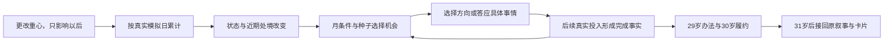

# 中国的一生 · 日常与成长验证版

**[当前试玩](https://three-weekends-yuki.yuki-uix.chatgpt.site/replica/)** · [原v2界面与存档](https://three-weekends-yuki.yuki-uix.chatgpt.site/life/previous.html) · [更早v1](https://three-weekends-yuki.yuki-uix.chatgpt.site/life-v1/) · [现行MVP范围](../docs/china-life-mvp.md) · [核心机制与原作证据](../docs/one8b-core-mechanics.md)

使用固定虚构人物陈知夏：女性，2005年出生于中国虚构城市澄江，父母经营维修铺。页面可从出生走到2090年、85岁结束；固定身份和结束年龄是内容对照条件，不是随机人口或寿命模型。

**连续投入与条件机会只接入去外省后的23—30岁。** 23岁快捷入口明示沿用固定求学前情；留本地路线和31岁以后大部分仍接原叙事，尚未形成贯穿整个人生的模拟。

## 运行与检查

```sh
cd web
npm run dev
```

打开 `http://127.0.0.1:4173/`。首页和 `/life/` 都转入 `/replica/`；`/life/previous.html` 与 `/life-v1/` 保留历史版本。纯HTML/CSS/JavaScript，无第三方运行依赖，无需安装或构建。

```sh
npm test
```

默认检查覆盖真实日数和分段投入、年内切换不可追溯改写、倍速与暂停门控、条件机会与种子重放、实际专精与合作、29岁方法和后续义务、完整人生接续、文字快照、v2迁移及界面呈现，并保留历史原型检查。检查数量不代表独立人生篇数，也不证明趣味成立。

## 当前核心循环

- 一年简化为360个模拟日、每月30日。时间真正经过时，作品、来往或安顿被记入本年与跨年的账本；选择重心本身不推进时间、不加经验，也不重新分配过去的日子。
- 实际投入逐步改变片子准备、剪辑熟练、备用金、精力与近期联系。工作繁忙与疲劳会影响效率；不同重心有不同代价，不能同时免费推高所有状态。
- 每个月只从当前符合条件的机会中按种子抽取。互看素材需要真实练习与能力；周舟来问采录需要实际来往与当前能联络上的处境。达到条件不等于一定马上出现，也不再固定等25或26岁预约合作。
- 选择结构或声音，只先形成练习方向；后续作品投入达到要求后，才记录真实完成过的经验。继续同样的作品重心，会因不同已完成方向遇到不同后续。
- 接下共同片段或后续试剪，只建立待做的事。要实际继续投入才能完成；暂停、换到不适用的重心或尚未做完，都不能获得完成事实。高一般熟练或常聊天不能替代真实共同作品。
- 29岁搬店与投稿的冲突保留。准备、精力、钱、近期联系与共同经历改变四种办法的可行性和成本；各办法保留署名、内容、在场和承诺上的具体取舍。30岁的承诺独占一部分后续投入，不能同时算给自己的练习。
- 到31岁接回原叙事；仍未实际做完的项目不会被当成已经完成。后来放映与晚年回顾区分提交、展出、个人或联名版本、亲历或收到视频。



## 页面与记录

沿用浅色生活主界面、顶部年龄与时间控制、直接重心选择、普通日志与加星。投入账本显示自主重心，30岁履约日数另列，避免一段时间被重复计算。重要决定弹窗暂停，可以收起查看处境，但收起不等于已经回答；作答后按进入前的自动或手动暂停模式继续。隐藏页面不计算离线投入。

普通日常按实际情况进入记录，不为每次切换重心发成果。选择和真正完成分别可识别，日志最新在前。结尾可挑选1—3段实际经历、填写最多80字的感想，预览并本地保存PNG；不会自动发布。

## 源文件与API

| 文件 | 当前职责 |
| --- | --- |
| `dist/replica/engine.js` | v3不可变状态、真实日数投入、月条件机会、种子、项目完成、严格重放与v2迁移 |
| `dist/replica/model.js` | 只读身份、真实尺度状态、投入月份、项目与完成事实的呈现适配 |
| `dist/replica/clock.js` | 现实时间换算成待推进的模拟日；暂停、后台与待答门控 |
| `dist/replica/app.js` / `style.css` | 生活界面、直接重心、账本、抉择、日志、存档与卡片编辑 |
| `dist/life/content.js` | 沿用的虚构出生、故事节点、人物与人生回顾内容 |
| `dist/life/living.js` | 沿用的旧尺度说明及29岁办法；其中年度结算与固定预约不再由v3调用 |
| `dist/life/engine.js` | 冻结的v2规则，用于严格核验旧存档与旧界面继续 |
| `dist/life/card.js` / `art.js` | 从本局记录绘制卡片，以及本项目SVG像素场景与人物 |
| `dist/life/previous.html` | 上一轮v2阅读界面，继续读取原键 |
| `tests/replica-engine.test.mjs` | 连续投入、条件机会、完成历史、重放与迁移检查 |
| `tests/replica-model.test.mjs` / `replica-clock.test.mjs` | 只读账本与状态呈现、时间换算和暂停检查 |
| `dist/life-v1/` | 更早的冻结完整人生与v1存档 |

核心API包括 `createGame(seed)`、`begin(state)`、`startYoungSample(seed)`、`advanceDays(state, days)`、`setFocus(state, id)`、`choose(state, choiceId)`、`getDecisionOptions(state)`、`getLifeView(state)`、`validateSave(raw)` 与 `migrateV2(raw, seed)`。大步推进仍经过每个模拟日和月检查，遇到待答或首次重心要求便停下；不能跳过机会或重复结算。

## 存档边界

当前状态版本为3，写入 `china-life.replica.save.v3`；界面选择仍用 `china-life.replica.ui.v1`。状态包含种子、随机进度、实际账本、项目、完成历史、选择和当时文字。恢复时从新开局或严格核验的v2来源重放受限命令，核对结果；拆分推进、刷新或切换倍速不会重抽已发生的机会。

没有v3时，页面可严格验证并接续已有的 `china-life.replica.save.v2`。迁移保留原年龄、事实、文字与待答选择，新的日数账本从接入当天开始；不能推测旧年度里各重心用了多少天。原键不删除、不回写。 后续若调整影响重放的规则或参数，须新增状态版本与迁移，不能直接改写已发布v3的过去。原 `china-life.save.v2` 仍由 `/life/previous.html` 读取，`china-life.save.v1` 仍由 `/life-v1/` 读取；校园存档独立保留。

当前并未实现全球出生与寿命模型、真实国家统计、完整职业经济、自由社交网、并行同龄人、实时AI事件、账号与公开结果页。借鉴的是投入、状态、机会与历史影响后续的循环，不宣称数值、概率或内容等同原作。Sites仍使用既有源仓库、静态打包与发布流程，沿用现有访问范围。

---

# 历史在线原型 大学慢慢来 今日安排

> 以下为保留的旧应用说明。当前首页已转到中国完整一生 `/life/`；旧校园存档与页面保持独立。

[在线体验连续八天](https://three-weekends-yuki.yuki-uix.chatgpt.site/fridays/)

从10月11日到18日，自己安排每天留给自己的那段课余。选片、动手两项能力可以持续练；到中途便出现试排片单、独自试放等新做法。第二个周五可以独立策划、开放教室、合作或赴私人邀约，条件提前可见，实际作品、职责和看片结果不同。

运行 `npm run dev` 后访问 `http://127.0.0.1:4173/fridays/`。无需安装依赖或构建。`npm test` 包含日历、时间预算、方法成长、具体目标结果及存档回放。片段使用 `campus-fridays.save.v2`；[具体范围](../docs/two-fridays-slice.md)。

---

# 大学慢慢来 · 一个秋天

[历史秋季试玩](https://three-weekends-yuki.yuki-uix.chatgpt.site/autumn.html)。v0.9 加入同伴的回访：平时有了真实往来或共同经历，他们会主动接旧话、邀请你一起过段课余。你也能主动找人，逐渐形成熟悉和默契。日常、共同活动与各人的习惯会影响之后的回应和分工。虚构中国南棠大学，日历独立推进，近期重心持续作用，普通记录自动出现，少量剧情才暂停等待决定。

这是节奏验证片段，只有入学后的三个月。完整大学四年、其他学制、更多国家与 sharing 后置。

## 本地运行

```sh
cd web
npm run dev
```

打开 `http://127.0.0.1:4173/autumn.html` 查看此秋季版本；`/fridays/` 为八天原型，首页转到 `/life/`。纯 HTML/CSS/JavaScript，无第三方运行依赖，`dist/` 是源码，无需构建。

```sh
npm test
```

日历、养成、历史分歧、人物回应与迁移测试覆盖持续安排、实际投入、能力与相识、剧情暂停、拒绝参与、后续回响、收藏、日期边界、项目准备与旧存档保留。人物回应另验收同一选择在不同相处历史下的差异、合作对后续分工的作用、后来的现场练习也能打开合作窗口、回应重放与旧待答选项保留；七场剧情的 21 个选项都有回应。原三场剧情的 27 种选项组合继续保留。历史 v0.3 的 22 项检查保留为 `npm run test:legacy`，不计为新版测试。

## 玩法与范围

- 新开局先询问这周的课余安排，避免直接沿默认生活快进；之后仍可调整。
- 选一个近期课余重心：随心过、常去社团、散步记录、和室友待着。安排会一直持续，可以调整，不用每周重新点击。
- 点击开始，日历自动前进；默认每模拟日 1.6 秒，可暂停、使用 1/2/4 倍速，或快进至下一次成长、准备完成或待答剧情。快进仍经过每一天并保留期间记录。
- 每七天按实际占用时间最多的重心写一条短记录，另有八条校园、天气和季节日常。普通日子不会强制发纪念物或要求领取成果。
- 记录、张罗随实际投入时间渐渐熟练；持续散步或参与社团，才会认识相关人物、在相应时间窗口遇到两场条件剧情。另有一场共同宿舍事件；同一事件也会回应室友相处、随心生活的实际习惯。
- 特殊剧情暂停日历；选择写回当日记录，并自动继续生活。选好练法、开始或恢复准备也直接续跑，不必再点一次继续。原三场剧情加两条主动项目后续，允许不参加；没有触发的剧情不阻碍时间。
- 能力达到入门后，可以主动开始「拍一组校园照片」或「筹一场小放映」；需要七天对应日常实际推进，换重心会暂停并保留进度。完成准备且达到第二阶段能力，才可能在时间窗口里遇到照片墙或自办放映；第三阶段多出独立安排的参与方式。开始时选择具体做法，只记录这次决定，不直接增加本领或生成完成物。
- 成长面板说明最近怎样练、已经会哪些做法，以及来自哪一次真实选择；取消剩余天数倒计时。基本入门、专长变化和准备完成用轻提示呈现，自动生活不中断，页面也不会被拉走。主动快进仍会在下一次变化处停下，留出调整机会。
- 日常和收藏均最新在上；翻阅旧日志时保持阅读锚点，新内容只提示条数，剧情选择后回到最新记录。
- 同样散步，可以练观察地方变化，也可以练倾听别人想留下什么；同样去社团，可以练内容策划，也可以练照顾同伴。项目开头与四个早期剧情选择会影响接下来的做法，选择卡预告影响，未来日常才积累经验。
- 方向可调整，旧经验不清零，旧成品保持原样。换练法会暂停采用原方法的准备；可以按原法恢复，或明确放下后试别的。
- 后续照片墙/人物记录、独立放映/散场交流各为一组。按实际经历与当前练法，每组每局至多发生一个版本；总共仍最多三场共同剧情加两场后续，不以全收集为目标。
- 所有经历与主动收藏分开；给某条记录加星才进入收藏，不自动生成奖品或精选回忆。
- 三位同伴各有回应方式：小满在意现场如何接住，林野在意倾听和拍摄边界，阿禾更容易从日常小事接话。熟悉取自对应日常的实际投入，合作取自已发生的共同事件；小满也会参考持续练过的现场协调。个人项目完成本身不当作对方的信任，拒绝不扣分。
- 点人物头像可以主动相处，每人两项：阿禾聊近况/一起吃饭，小满聊电影/一起试设备，林野聊这两天/沿湖拍照。按钮提前显示下一段课余的日期；提交会到次日，不另开统一成果页，也不用手动再点继续。
- 主动相处替代该日常规重心：只记入 `socialDays`，不同时加基础本领、专长或项目进度，长期重心保持原样，之后的日子照常恢复。周记根据真正花过的时间写，社交占多数时会引用真实相处记录。
- 伙伴有可复现的忙碌日程，暂时约不上会先显示原因与下一可约日，不消耗时间。与同一人相处至少留两日，共同活动本身间隔四日；聊天形成熟悉，实际活动每两次增加一份合作依据，最多两份。纯聊天不替代现场合作。初次、再次和接续旧话的回应不同，旧话题引用真实记录，不按点击次数送礼或颁发成果。
- 至少三次真实往来，或已熟悉且实际一起参与过故事后，同伴可能主动来找你；距上次相处至少三天，只在普通日常推进时发来，刚做完选择不立即回礼。邀请引用实际来源，按最久未回访的人与真实经历排序，最多同时一份；全局来信至少隔七天，同人至少十天，回复后也留空当。
- 来信不暂停自动时间，不抢阅读焦点；日历旁有入口。明确点开细读时暂歇日历，避免倍速下读到一半过期，合上后回到原节奏。可用下一段课余接受，也可婉拒、晚点再看。稍后状态保存在浏览器，刷新仍收起；人物页和日志保留来访记录。十个模拟日内未排上便静默归档，不扣关系。主动快进会在新信出现时停下。
- 发信、婉拒和过期均不算相处；接受才使用一天，并记录 `initiator: npc`。当前伙伴忙碌或有待答剧情时，接受按钮说明原因。主动从人物页另约同一人会同步收掉旧信：同项标为已排上，改做别的也不再挂着催约。原长期重心、技能和项目不会额外双算。
- 回应在选择前判断，写入这次事件后固定保存；读日志或刷新不会重新摇结果。回应暂留在页面上供阅读，日历仍运行，遇到下一场决定才暂停；可以收起，也能在人物详情回看最近三次相处。连续同日剧情保留上一次回应，不增加“读完继续”步骤。
- 后续放映的分工同时受本领与合作依据影响：有经验时小满可以交钥匙、让你先带新人开门接人；仍不熟悉做事习惯时先搭档确认。早期只看片的人，也能之后实际练习现场协调，逐渐获得这份托付。独立或搭档不设结局评分。
- 查看人物、自己或重开确认时暂时冻结日历，合上（包括 Escape）后保持打开前的运行或暂停状态；切到其他标签页会暂停，返回后手动继续。重新打开停在保存日期，不计算离线时间。
- 仍为两项本领、三位同伴。没有资金、压力条、求职、课程表或人生排名。

## 文件

- `dist/calendar-content.js`：四个持续重心、周记、季节记录、三场条件剧情、后续回响与日期文案。
- `dist/campus-reactions.js`：人物习惯、派生相处依据、21 个选择的回应变体，以及后续场景和回响的条件文案。
- `dist/campus-social.js`：六项主动相处、个人日程、可约日期、往来间隔与连续相处的对白。
- `dist/campus-invitations.js`：由前史触发的同伴回访、邀约内容、接旧话与由谁发起的记录。
- `dist/calendar-engine.js`：独立日历、时间积累、剧情条件、人物相识、选择与收藏、严格命令重放校验。
- `dist/app.js`：时间控制、持续重心、日常时间线、剧情面板、人物/成长查看与本地保存。
- `dist/campus-art.js`、`dist/styles.css`：沿用克制像素视觉，本地字体与原生 SVG。
- `tests/calendar.test.mjs`、`tests/growth.test.mjs`、`tests/history.test.mjs`、`tests/reaction.test.mjs`、`tests/social.test.mjs`、`tests/invitations.test.mjs`：日历、基础养成、历史分歧、双向相处与迁移检查。
- `dist/calendar-engine-v4.js` / `calendar-content-v4.js`、v5/v6/v7/v8 对应文件及旧版 reactions/social 模块：冻结的旧规则，用于严格核验旧存档与原待答场景。
- `dist/engine.js`、`dist/content.js`、旧测试：保留的 v0.3 历史实现，当前入口不加载。
- `.openai/hosting.json`：复用原 Sites 身份与静态目录。

## 存档与扩展

当前键 `campus-slowly.save.v9`。v0.4 至 v0.8 记录先通过冻结旧规则严格核验，再作为原始历史接续；日期、能力、人物、练法、项目、文字、回应、已发生的相处、事件 ID 与收藏保留，旧键不覆盖。旧待答剧情的文案和可用选项仍按原规则。过去没有出现过的回应、相处或邀请不会补造；已有真实共同经历可成为之后新回访的依据。新练法不会从旧历史推断或倒填。旧 v1/v2/v3 也保留。只保存到当前浏览器。恢复时重放核对事实与回应，已有文字快照保留。坏存档不会被读取过程自动覆盖，用户可明确重开。

国家内容、日历与通用规则分开。后续分享可从事实日志与收藏读取，本轮未实现分享、多用户、全球随机出生或四年内容。

## 字体与发布

本地提供 [TakWolf / Fusion Pixel Font](https://github.com/TakWolf/fusion-pixel-font) 2026.10.25 的 12px proportional 简体字形，OFL 与上游组件许可保留于 `dist/fonts/`。校园与人物为本项目原生 SVG。

Sites 使用独立部署源仓库，`web/` 是本 GitHub 仓库的同版应用源。复制至 Sites 检出，经 source helper 推送、打包，再用原生工具发布。沿用既有网址与访问范围；本地修改不会自动上线。

## 同样投入的对照验收

两局先按观察方式做成同一组照片，散步至同一天。在同一湖边事件中，分别选择复拍旧角度、陪同伴走走聊聊。继续投入相同散步时间后，两局的总天数、基础熟悉度和旧成品完全一致，但实际专长和后续分别是照片墙、人物记录。社团的帮忙/看片也验证了同样差异，分别进入散场交流、自办放映。

浏览器走查覆盖旧记录接续、项目做法选择、调整练法后准备暂停与恢复、选择前影响提示、来源回看、普通周记与另一场后续的出现。数值一致与剧情可达不代替用户判断是否好玩。
